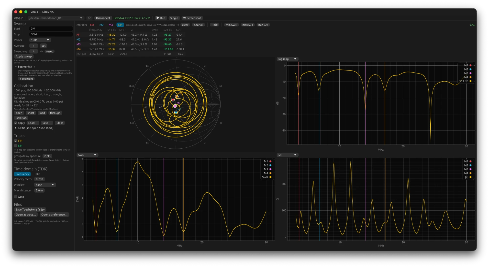

# vna-r

Desktop software for the **LiteVNA 64/67** and the **NanoVNA-F** vector network analysers on macOS
and Linux, written in Rust: a device library, a command line tool (`vna-cli`) and a GUI (`vna-gui`).
Sweeps, SOLT calibration with kit fit, Smith chart and seven trace views, markers, references with a
difference trace, segments, time-domain reflectometry (TDR) with gating, and Touchstone import and
export. Hobby project by Bas Hendriks, PA1BH.

Status: version 0.2.0, verified on a LiteVNA 64, a LiteVNA 67 and a NanoVNA-F 4.3, on macOS and on
Linux (NixOS). Changes per version are in [CHANGELOG.md](CHANGELOG.md).



## Getting it

**Download.** Every release on the [Releases page](https://github.com/pa1bh/vna-r/releases) carries
tarballs for Apple Silicon macOS and x86_64 Linux with `vna-cli`, `vna-gui`, the manual and a
checksum. The binaries are dynamically linked: on Linux they need `libudev` and GTK 3 from your
distribution. There is no code signing yet, so macOS may ask you to allow the app in
*System Settings ▸ Privacy & Security* the first time.

**NixOS.** The repository is a flake:

```bash
nix --extra-experimental-features 'nix-command flakes' run github:pa1bh/vna-r
```

The package also ships the udev rule (`services.udev.packages = [ vna-r ];`). The release tarballs
do not run on NixOS; use the flake there.

**Build from source.** You need a Rust toolchain (stable). On Debian/Ubuntu also:

```bash
sudo apt-get install -y pkg-config libudev-dev libgtk-3-dev
```

Then:

```bash
cargo build --release
```

The binaries land in `target/release/`. `cargo run --release -p vna-gui` starts the GUI directly.

**Serial port access on Linux.** Copy [linux/99-litevna.rules](linux/99-litevna.rules) to
`/etc/udev/rules.d/` and reload udev (instructions in the file), or add yourself to the `dialout`
group. The port is `/dev/ttyACM*`; on macOS it is `/dev/cu.usbmodem…` and no driver is needed.

## Quick start

1. Connect the analyser over USB and start `vna-gui`. The port list marks a VNA with `*` and
   selects it; it rescans every two seconds until you connect.
2. **Connect**, then **Run** (continuous) or **Single**. The top bar shows model, firmware and battery.
3. Set **Start**, **Stop** and **Points** under **Sweep** and press **Apply sweep**. Frequencies are
   typed as `50k`, `14.2M`, `1.3G`.
4. Calibrate: under **Calibration**, measure **open**, **short** and **load** (optionally **through**
   and **isolation**) on the current grid, tick **apply**, and **Save…** the calibration as JSON. The
   same file works with `vna-cli sweep --cal`. An implausible standard (a loose open, a forgotten
   load) gets a warning.
5. Place markers by clicking in a plot or on the Smith chart; **Hold** keeps the current trace as a
   reference, and **Δ** next to a reference draws live minus reference in every view.

The menu bar has **File** (Touchstone and calibration files), **Device**, **View** and **Help**,
with **Help ▸ About** showing the version and build. Settings (port, sweep, calibration file,
views, TDR, markers, window size) are saved on exit and restored at the next start.

The same from the command line:

```bash
vna-cli list                       # serial ports, with the VNA marked
```

```bash
vna-cli info                       # model, protocol, hardware, firmware, battery
```

```bash
vna-cli cal open --file hf.cal.json --start 1M --stop 30M --points 201   # then short, load
```

```bash
vna-cli sweep --cal hf.cal.json --s2p antenna.s2p
```

```bash
vna-cli tdr --cal hf.cal.json --vf 0.70 --max-distance 3                  # reflections by distance
```

```bash
vna-cli screenshot --out screen.png
```

`vna-cli --help` and `vna-cli <command> --help` list every option. `--trace` prints each byte sent
and received, `peek F0` reads a LiteVNA register. After a sweep the CLI hands the screen back to the
device; `vna-cli release` does that on its own.

## What it does

- **Views.** Smith chart (S11) plus three plots that each pick their own view: log magnitude, linear
  magnitude, phase, SWR, R + jX, |Z| or group delay. S11 and S21 can be shown or hidden; double-click
  resets the zoom.
- **Calibration.** SOL(T) with open/short/load/through/isolation on any grid, interpolated to other
  grids within the calibrated range, saved as JSON. Above about 1 GHz the **Kit fit** estimates the
  open/short asymmetry of the kit from a cable measured with open and short at the far end (as a
  capacitance or an offset delay) and **Apply to kit** puts it into the calibration.
  `vna-cli cal check` reports what a calibration leaves over on a cable measurement.
- **Segments.** Extra frequency ranges swept after the first and shown as one trace, each with its
  own calibration file if you like, for example 100 kHz–50 MHz with an HF calibration next to
  50 MHz–6.3 GHz with a wide one. CLI: `--segment 100k:50M:1001@hf.cal.json`.
- **Markers.** Four markers with a table of frequency, S11, Z, SWR and S21 and the difference between
  the first two; arrow keys nudge the active one (shift: ten points), buttons jump to minimum SWR,
  maximum S21 or minimum S21.
- **References and Δ.** Up to four held traces with name and colour; the difference trace is drawn
  in the unit of each view (dB, degrees, SWR, ohm, nanoseconds). References are not saved: export
  them as .s2p and open them as a reference later.
- **Averaging.** The device's own averaging (LiteVNA, 1–80) and a complex software average of the
  last N sweeps, which lowers noise without biasing the magnitude the way averaging in dB does.
- **Time domain.** TDR from the sweep (window, velocity factor, distance axis), and a draggable
  **Gate** that keeps or removes (*notch*) the reflections between two distances; the frequency
  view then shows the gated S11. CLI: `vna-cli sweep --gate 0.9:1.2`, `vna-cli tdr --from file.s2p`.
- **Files.** Touchstone .s1p/.s2p export and import (RI/MA/DB, Hz to GHz, including files written by
  the analyser itself), as the live trace or as a reference; device screenshots as PNG.
- **Developer tools.** Off by default; **View ▸ Developer tools** adds a log window and
  **Copy diagnostics** for bug reports.

## Devices

Two protocols behind one `Vna` handle, chosen by USB id:

| Device | Protocol | Status |
|---|---|---|
| **LiteVNA 64 and 67** | binary register protocol, USB `04B4:0008` | verified on both; same protocol and registers, different screen and USB name; 50 kHz–6.3 GHz |
| **NanoVNA-F 4.3** (firmware 1.0.4) | text shell, USB `0483:5740` | verified: `scan_bin` in chunks of 301 points, about 115 points/s, 800×480 screenshots; 10 kHz–1.5 GHz. No LiteVNA registers, so no `peek`, `--average` or device averaging |
| NanoVNA-H / H4, LiteVNA-H1 | same shell family | untested; should work when the firmware has `scan_bin` |
| Other NanoVNA V2 (same USB id as the LiteVNA) | binary register protocol | untested |

## Documentation

- **Manual** (Dutch, for now): [docs/handleiding](docs/handleiding/README.md). What a VNA measures,
  installing, the GUI, calibrating, TDR and gating, measurement recipes, files, the CLI, devices and
  troubleshooting. Every GUI label in the manual is the English label you see on screen, so it is
  usable with a translator.
- **Research notes** (Dutch): [docs/01-onderzoek-protocol.md](docs/01-onderzoek-protocol.md) (LiteVNA
  protocol as measured), [docs/06-nanovna-shell-protocol.md](docs/06-nanovna-shell-protocol.md)
  (NanoVNA-F shell), [docs/03-calibratie.md](docs/03-calibratie.md) (calibration model with
  measurements), [docs/04-tdr.md](docs/04-tdr.md) (TDR mathematics), [docs/05-roadmap.md](docs/05-roadmap.md).
- **Changes**: [CHANGELOG.md](CHANGELOG.md).

## Reporting problems

Open an issue at <https://github.com/pa1bh/vna-r/issues> (**Help ▸ Report a problem…** in the GUI).
Please include the version (**Help ▸ About** or `vna-cli --version`), your device and firmware, and
what you did. Easiest: turn on **View ▸ Developer tools**, choose **Developer ▸ Copy diagnostics**
and paste the result. For CLI problems, the output with `--trace` helps.

## Project layout

| Crate | What |
|---|---|
| `crates/litevna` | Library: LiteVNA register protocol and NanoVNA text shell, port discovery, SOLT calibration with kit fit and interpolation, trace maths, TDR and gating, Touchstone. No UI. |
| `crates/vna-cli` | Command line tool on top of the library. |
| `crates/vna-gui` | Desktop GUI (egui/eframe). |

[.github/workflows/ci.yml](.github/workflows/ci.yml) builds and tests on Ubuntu and macOS and builds
the Nix flake on every push.

## Versions and releases

The version number lives once in `Cargo.toml` under `[workspace.package]` and applies to the library,
`vna-cli`, `vna-gui` and the flake. The GUI shows it in the title bar and under **Help ▸ About** (with
the git revision recorded by `build.rs`), the CLI with `vna-cli --version`.

To cut a release:

1. Put the new number in `Cargo.toml`, move the items under *Unreleased* in `CHANGELOG.md` to a
   section `## [X.Y.Z] - date`, and commit.
2. Tag and push:

   ```bash
   git tag -a v0.2.0 -m "vna-r 0.2.0" && git push origin main v0.2.0
   ```

3. [release.yml](.github/workflows/release.yml) checks that the tag matches the version in
   `Cargo.toml`, builds the tarballs and creates the GitHub release with the changelog section as
   its text.

## Licence

MIT, see [LICENSE](LICENSE).
