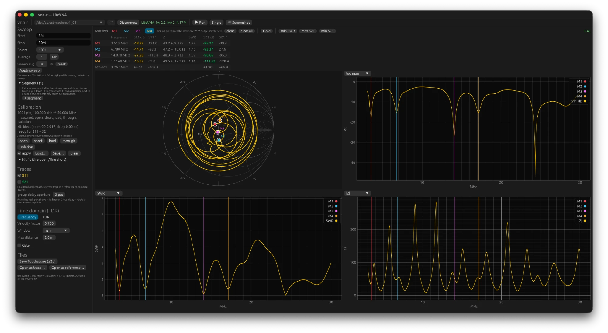

# vna-r

Desktop software for the **LiteVNA 64/67** and the **NanoVNA-F** vector network analysers on macOS,
Linux and Windows, written in Rust: a device library, a command line tool (`vna-cli`), a GUI (`vna-gui`)
and a server (`vna-server`) for measuring over the network, from the program or from a browser.
Sweeps, SOLT calibration with kit fit, Smith chart and seven trace views, markers, references with a
difference trace, segments, time-domain reflectometry (TDR) with gating, and Touchstone import and
export. Hobby project by Bas Hendriks, PA1BH.

Status: verified on a LiteVNA 64, a LiteVNA 67 and a NanoVNA-F 4.3, on macOS and on Linux (NixOS,
Fedora, and Fedora Asahi Remix on an M1 with the `aarch64-linux` archive); the Windows build has not been tried with a device yet.
`vna-server` has been tried on macOS with a LiteVNA 67 and on a Raspberry Pi 4 (Raspberry Pi OS on
Debian 13, the `aarch64-linux` archive as a systemd service) with a NanoVNA-F, with the program and a
browser as its clients. The current version is in
`Cargo.toml`; changes per version are in [CHANGELOG.md](CHANGELOG.md).



## Getting it

**Download.** Every release on the [Releases page](https://github.com/pa1bh/vna-r/releases) carries
an archive per platform with `vna-cli`, `vna-gui`, `vna-server`, the manual (English and Dutch) and a
checksum; the Linux archives also hold the udev rule and a systemd unit for the server:

| Archive | For |
|---|---|
| `…-aarch64-macos.tar.gz` | Mac with Apple Silicon (M1 and later) |
| `…-x86_64-macos.tar.gz` | Mac with an Intel processor |
| `…-x86_64-linux.tar.gz` | Linux on x86_64; needs `libudev` and, for the file dialogs, an `xdg-desktop-portal` (every desktop environment ships one; not NixOS, see below) |
| `…-aarch64-linux.tar.gz` | Linux on arm64 (Asahi Linux on Apple Silicon, Raspberry Pi); same requirements as x86_64 |
| `…-x86_64-windows.zip` | Windows 10 or 11 on x86_64 |
| `…-web.zip` | the browser page on its own (three static files), for a website |

Nothing is code-signed yet. **macOS** therefore refuses to start a binary that was downloaded with a
browser and unpacked with the Finder ("cannot be opened because the developer cannot be verified").
Either unpack in the Terminal, which does not mark the files:

```bash
tar xzf vna-r-v*-aarch64-macos.tar.gz
```

or remove the mark after unpacking:

```bash
xattr -dr com.apple.quarantine vna-r-v*-aarch64-macos
```

**Windows** shows a SmartScreen warning for the same reason; *More info ▸ Run anyway* starts it. The
Windows build compiles and passes CI but has not yet been tried with a device; reports are welcome.
Ports are `COM` ports; Windows 10 and later include the USB serial driver that the LiteVNA and
NanoVNA-F use.

**NixOS.** The repository is a flake:

```bash
nix --extra-experimental-features 'nix-command flakes' run github:pa1bh/vna-r
```

The package also ships the udev rule (`services.udev.packages = [ vna-r ];`), and `#vna-server`
runs the server (without the browser page built in; `vna-gui` connects to it all the same). The
release tarballs do not run on NixOS; use the flake there.

**Build from source.** You need a Rust toolchain (stable, 1.95 or later). On Debian/Ubuntu also:

```bash
sudo apt-get install -y pkg-config libudev-dev
```

Then:

```bash
cargo build --release
```

The binaries land in `target/release/`. `cargo run --release -p vna-gui` starts the GUI directly.

If cargo stops with `rustc 1.xx is not supported by the following packages`, it is using
an older Rust than the one you think you have: a toolchain that rustup installed earlier
takes precedence over the one from your distribution. `rustup update stable` brings it up
to date.

**Graphics on Linux.** The GUI draws with wgpu and prefers Vulkan, except on drivers known to
stutter (NVK on older NVIDIA cards under nouveau) or software rasterisers, where it picks OpenGL. If
menus feel sluggish, check the renderer line under **Help ▸ About vna-r** and try `WGPU_BACKEND=gl`; the
manual's troubleshooting chapter has more.

**File dialogs on Linux.** Open and Save go through the desktop portal (`xdg-desktop-portal`
with the backend of your desktop: GTK, KDE, GNOME, wlr). Without a running portal, as on a bare
window manager, the dialogs do not appear and nothing is opened or saved; install and start a
portal backend in that case. The GUI reaches the portal through `libdbus-1.so.3`, which it loads
when the first dialog opens; every desktop distribution has it, and the flake puts it on the
library path.

**Serial port access on Linux.** Copy [linux/70-litevna.rules](linux/70-litevna.rules) to
`/etc/udev/rules.d/` and reload udev (instructions in the file), or add yourself to the `dialout`
group. The port is `/dev/ttyACM*`; on macOS it is `/dev/cu.usbmodem…` and no driver is needed.

## Quick start

1. Connect the analyser over USB and start `vna-gui`. The port list marks a VNA with `*` and
   selects it; it rescans every two seconds until you connect.
2. **Connect**, then **Run** (continuous) or **Single**; while something is being measured the
   button reads **Stop**. The top bar shows model, firmware and battery.
3. Set **Start**, **Stop** and **Points** under **Sweep** and press **Apply sweep** (or Return in
   Start or Stop). Frequencies are typed as `50k`, `14.2M`, `1.3G`.
4. Calibrate: under **Calibration**, measure **open**, **short** and **load** (optionally **through**
   and **isolation**) on the current grid, tick **apply**, and **Save…** the calibration as JSON. The
   same file works with `vna-cli sweep --cal`. An implausible standard (a loose open, a forgotten
   load) gets a warning.
5. Place markers by clicking in a plot or on the Smith chart; **Hold** keeps the current trace as a
   reference, and **Δ** next to a reference draws live minus reference in every view.

The menu bar has **File** (Touchstone and calibration files), **Device**, **View** and **Help**,
with **Help ▸ About vna-r** showing the version and build. Settings (port, sweep, calibration file,
views, TDR, markers, references, window size) are saved on exit and restored at the next start.

The same from the command line:

```bash
vna-cli list                       # serial ports, with the VNA marked
```

```bash
vna-cli info                       # model, protocol, hardware, firmware, battery
```

```bash
vna-cli cal open --file hf.cal.json --start 1M --stop 30M --points 201   # then short, load
```

```bash
vna-cli sweep --cal hf.cal.json --s2p antenna.s2p
```

```bash
vna-cli tdr --cal hf.cal.json --vf 0.70 --max-distance 3                  # reflections by distance
```

```bash
vna-cli screenshot --out screen.png
```

`vna-cli --help` and `vna-cli <command> --help` list every option. `--json` gives machine-readable
output for scripts, `--trace` prints each byte sent and received, `peek F0` reads a LiteVNA
register. After a sweep the CLI hands the screen back to the device; `vna-cli release` does that on
its own.

## Measuring over the network

Put the analyser on a small computer, a Raspberry Pi with a 64-bit Raspberry Pi OS for example, and
run `vna-server` there (the `aarch64-linux` archive has a systemd unit for it). Then open
`http://<that computer>:8080/` in any browser on the same network, or choose **Device ▸ Add server…**
in `vna-gui` and pick the server in the port list. Several people can watch and steer one analyser;
each calibrates in their own program or browser. There is no password yet, so use it on a network
you trust. `vna-server --simulate` gives a simulated analyser to try it without one. A LiteVNA
that charges from the USB of a Raspberry Pi can ask for more current than the Pi's ports give and
then keeps dropping out; a USB hub with its own power supply is the likely cure. The manual
has the details: [chapter 10](docs/manual/10-network.md) (Dutch:
[hoofdstuk 10](docs/handleiding/10-netwerk.md)).

## What it does

- **Views.** Smith chart (S11) plus three plots that each pick their own view: log magnitude, linear
  magnitude, phase, SWR, R + jX, |Z| or group delay. S11 and S21 can be shown or hidden. The three
  frequency plots share one frequency axis; **reset view** or a double-click puts them back on their
  automatic scale. **View ▸ Zoom** scales the whole interface (75–250 %).
- **Bands.** **View ▸ Amateur bands** draws the amateur bands behind the plots, IARU Region 1 or
  Region 2; the **Band** row in the sweep panel sets Start and Stop to a band with 10 % of its width
  extra on each side, for tuning a multiband antenna band by band.
- **Calibration.** SOL(T) with open/short/load/through/isolation on any grid, interpolated to other
  grids within the calibrated range, saved as JSON. Above about 1 GHz the **Kit fit** estimates the
  open/short asymmetry of the kit from a cable measured with open and short at the far end (as a
  capacitance or an offset delay) and **Apply to kit** puts it into the calibration.
  `vna-cli cal check` reports what a calibration leaves over on a cable measurement.
  **Port extension** moves the reference plane by a delay, for an adapter or fixture behind
  the calibration plane. **sweep from calibration** sets the sweep to the calibration's own grid,
  so that nothing is interpolated; a calibration that jumps between adjacent points (the LiteVNA 67
  around 100 MHz) gives a warning when it is interpolated across the jump.
- **Segments.** Extra frequency ranges swept after the first and shown as one trace, each with its
  own calibration file if you like, for example 100 kHz–50 MHz with an HF calibration next to
  50 MHz–6.3 GHz with a wide one; **log spacing** moves the segment edges so that every segment
  spans the same ratio. CLI: `--segment 100k:50M:1001@hf.cal.json`.
- **Markers.** Four markers with a table of frequency, S11, Z, the reactance as L or C, SWR and S21
  and the difference between the first two; arrow keys nudge the active one (shift: ten points), buttons jump to minimum SWR,
  maximum S21 or minimum S21. Markers keep their frequency when the sweep changes.
- **Keys.** Space is Run or Stop, `S` a single sweep, `1`–`4` choose the marker, `H` holds a
  reference, `G` switches the gate, `T` switches between frequency and time domain.
- **References and Δ.** Up to four held traces with name and colour; the difference trace is drawn
  in the unit of each view (dB, degrees, SWR, ohm, nanoseconds). References are kept between
  sessions; any .s1p/.s2p file can be opened as a reference too.
- **Averaging.** The device's own averaging (LiteVNA, 1–80) and a complex software average of the
  last N sweeps, which lowers noise without biasing the magnitude the way averaging in dB does;
  **drop** leaves the outliers out of that average.
- **S21 offset.** Adds the value of an attenuator in front of port 2 back to S21, so that the plot
  and the files show the device under test alone.
- **Time domain.** TDR from the sweep (window: rectangular, hann, blackman, kaiser 6 or 13;
  velocity factor from a cable list or typed; distance axis), and a draggable
  **Gate** that keeps or removes (*notch*) the reflections between two distances; the frequency
  view then shows the gated S11. CLI: `vna-cli sweep --gate 0.9:1.2`, `vna-cli tdr --from file.s2p`.
- **Files.** Touchstone .s1p/.s2p export and import (RI/MA/DB, Hz to GHz, including files written by
  the analyser itself), as the live trace or as a reference; device screenshots as PNG. The CLI
  also writes CSV (with impedance and group delay) and, with `--json`, machine-readable output.
- **Connection.** When the device drops off the USB bus the GUI waits up to 30 s for it to come
  back and reconnects; a sweep that was running continues.
- **Over the network.** `vna-server` drives the analyser on a computer it is plugged into and serves
  the interface to browsers on the network; `vna-gui` connects to it like to a port. When the network
  or the server drops, the program waits for it and carries on. Design note:
  [docs/10-client-server.md](docs/10-client-server.md) (Dutch).
- **In the browser.** The same GUI builds to WebAssembly. Served by `vna-server` it measures; as a
  page of its own it is a viewer for Touchstone files that opens with an example measurement, and
  it measures too once a server is added. `scripts/build-web.sh` writes the three static files to
  `target/web`; every release has them as `…-web.zip`. Files stay in the browser. Notes in
  [docs/09-wasm-proef.md](docs/09-wasm-proef.md) (Dutch).
- **Developer tools.** Off by default; **View ▸ Developer tools** adds a log window and
  **Copy diagnostics** for bug reports.

## Devices

Two protocols behind one `Vna` handle, chosen by USB id:

| Device | Protocol | Status |
|---|---|---|
| **LiteVNA 64 and 67** | binary register protocol, USB `04B4:0008` | verified on both; same protocol and registers, different screen and USB name; 50 kHz–6.3 GHz |
| **NanoVNA-F 4.3** (firmware 1.0.4) | text shell, USB `0483:5740` | verified: `scan_bin` in chunks of 301 points, about 115 points/s, 800×480 screenshots; 10 kHz–1.5 GHz. No LiteVNA registers, so no `peek`, `--average` or device averaging |
| NanoVNA-H / H4, LiteVNA-H1 | same shell family | untested; should work when the firmware has `scan_bin` |
| Other NanoVNA V2 (same USB id as the LiteVNA) | binary register protocol | untested |

## Documentation

- **Manual**: [docs/manual](docs/manual/README.md) (English) or
  [docs/handleiding](docs/handleiding/README.md) (Dutch). What a VNA measures, installing, the GUI,
  calibrating, TDR and gating, measurement recipes, files, the CLI, devices and troubleshooting,
  measuring over the network.
- **Research notes** (Dutch): [docs/01-onderzoek-protocol.md](docs/01-onderzoek-protocol.md) (LiteVNA
  protocol as measured), [docs/06-nanovna-shell-protocol.md](docs/06-nanovna-shell-protocol.md)
  (NanoVNA-F shell), [docs/03-calibratie.md](docs/03-calibratie.md) (calibration model with
  measurements), [docs/04-tdr.md](docs/04-tdr.md) (TDR mathematics), [docs/05-roadmap.md](docs/05-roadmap.md).
- **Changes**: [CHANGELOG.md](CHANGELOG.md).
- **Working on the code**: [CONTRIBUTING.md](CONTRIBUTING.md) (layout, conventions, checks).

## Reporting problems

Open an issue at <https://github.com/pa1bh/vna-r/issues> (**Help ▸ Report a problem…** in the GUI).
Please include the version (**Help ▸ About vna-r** or `vna-cli --version`), your device and firmware, and
what you did. Easiest: turn on **View ▸ Developer tools**, choose **Developer ▸ Copy diagnostics**
and paste the result. For CLI problems, the output with `--trace` helps.

## Project layout

| Crate | What |
|---|---|
| `crates/litevna` | Library: LiteVNA register protocol and NanoVNA text shell, port discovery, SOLT calibration with kit fit and interpolation, trace maths, TDR and gating, Touchstone. No UI. |
| `crates/vna-cli` | Command line tool on top of the library. |
| `crates/vna-gui` | Desktop GUI (egui/eframe). |
| `crates/vna-link` | Between the GUI and the analyser: commands in, events out, from a device thread or a vna-server. |
| `crates/vna-server` | Headless server: the analyser on USB (a Raspberry Pi, say), the GUI over a WebSocket on the LAN. |

[.github/workflows/ci.yml](.github/workflows/ci.yml) checks formatting and clippy, builds and
tests on Ubuntu (x86_64 and arm64), macOS and Windows, builds the browser version for wasm32
with clippy, checks that the two manuals have the same structure
([scripts/check-manuals.sh](scripts/check-manuals.sh)) and builds the Nix flake on every push.

## Versions and releases

The version number lives once in `Cargo.toml` under `[workspace.package]` and applies to the library,
`vna-cli`, `vna-gui`, `vna-server` and the flake. The GUI shows it in the title bar and under **Help ▸ About vna-r** (with
the git revision recorded by `build.rs`), the CLI with `vna-cli --version`.

To cut a release:

1. Put the new number in `Cargo.toml`, move the items under *Unreleased* in `CHANGELOG.md` to a
   section `## [X.Y.Z] - date`, and commit.
2. Tag and push:

   ```bash
   git tag -a v0.2.0 -m "vna-r 0.2.0" && git push origin main v0.2.0
   ```

3. [release.yml](.github/workflows/release.yml) checks that the tag matches the version in
   `Cargo.toml`, builds the archives for Linux (x86_64 and arm64), both Macs and Windows, and creates the GitHub
   release with the changelog section as its text.

A release candidate works the same way with a version such as `0.3.0-rc.1` and the tag
`v0.3.0-rc.1`; a tag with a suffix is published as a pre-release. When it is approved, merge
the changelog sections of the candidates into one for the final number and release that.

## Licence

MIT, see [LICENSE](LICENSE).
