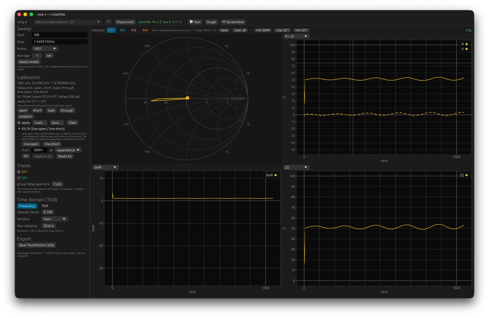
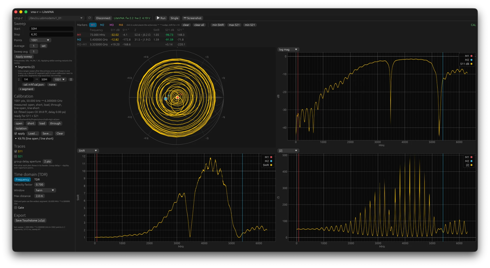
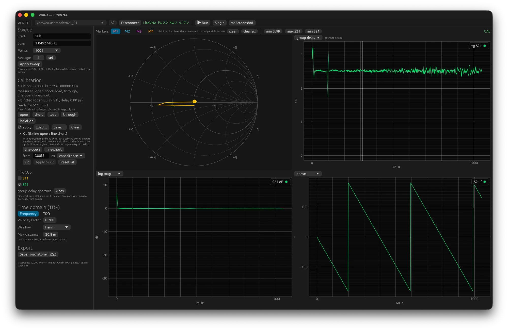

# 3. De GUI

Start met `cargo run --release -p vna-gui` of `target/release/vna-gui`. Het venster heeft een
menubalk, een werkbalk (poort, verbinding, Run), een linkerpaneel met instellingen en een
hoofdgebied met vier grafieken. De titelbalk toont het versienummer.

## Menubalk

- **File**: Touchstone-bestanden openen als trace of referentie, opslaan als .s2p,
  calibratie laden en opslaan, afsluiten. Dezelfde knoppen staan ook in het linkerpaneel.
- **Device**: Connect of Disconnect, poorten opnieuw zoeken, Run, Stop, een enkele sweep
  en een schermafbeelding van het apparaat.
- **View**: frequentiedomein of tijddomein (TDR), S11 en S21 aan of uit, **Amateur
  bands** (de amateurbanden van IARU-regio 1 als grijze achtergrond met hun naam in de
  drie frequentiegrafieken, zodat je direct ziet of een dip in de band ligt), **Zoom** (de
  grootte van de tekst en al het andere, zie hieronder), **Connect at start** (vanzelf
  verbinden als het programma start en er een VNA aangesloten is; standaard uit) en de
  schakelaar **Developer tools**.
- **Help**: de handleiding op GitHub in het Engels en het Nederlands, zoals die bij jouw
  versie hoort, de probleemmelder, en **About vna-r** met versie, build-revisie, auteur en
  de link naar het project.

**Developer tools** staat normaal uit. Aan zet het een menu **Developer** erbij met een
logvenster (verbindingen, fouten, bestandsbewerkingen en, zolang het venster open is,
elke sweep met puntenaantal en duur) en **Copy diagnostics**: dat zet versie, apparaat,
sweep-instellingen, calibratie, de laatste fout en het log als tekst op het klembord. Plak
dat in een probleemmelding (hoofdstuk 9). De keuze wordt bewaard.

### Grotere of kleinere tekst

**View ▸ Zoom** stelt de grootte in van alles in het venster, tekst en grafieken, van 75%
tot 250%; het menu toont de grootte die in gebruik is. Met het toetsenbord gaan Ctrl met +
en Ctrl met − (op een Mac ⌘ in plaats van Ctrl) in stappen van 10%, en Ctrl met 0 gaat
terug naar 100%. De grootte wordt bewaard. Een grote instelling laat minder ruimte voor de
grafieken; maak het venster groter of scrol in het linkerpaneel.

## Verbinden en sweepen

1. Kies de poort in de keuzelijst; een VNA heeft een ster en wordt vanzelf gekozen. De
   lijst wordt elke twee seconden ververst zolang je niet verbonden bent, dus een
   apparaat dat je later aansluit verschijnt vanzelf; **rescan** zoekt direct.
2. **Connect**. De bovenbalk toont model, firmware en batterijspanning. Valt de
   verbinding weg, dan wacht het programma op het apparaat en verbindt het zelf opnieuw
   (hoofdstuk 9).
3. **Run** start continu sweepen, **Single** doet er één. Zolang er iets gemeten wordt
   (de continue sweep, een enkele sweep of een calibratiestandaard) staat op de plaats
   van Run de knop **Stop**.
   Een sweep die meer dan een ogenblik duurt (een NanoVNA-F, veel punten) toont een balk
   met de punten die al gemeten zijn. **Stop**, **Disconnect** en **Apply sweep** wachten
   niet tot de sweep klaar is: ze werken bij het volgende blok gegevens, binnen 255
   punten op een LiteVNA en binnen 301 punten (ongeveer drie seconden) op een NanoVNA-F.

Toetsen, zolang je niet in een veld typt: spatie is Run of Stop, `S` een enkele sweep,
`1` tot `4` kiezen de actieve marker en de pijltjestoetsen verplaatsen hem, `H` houdt de
trace vast als referentie, `G` schakelt de gate, `T` wisselt tussen frequentie- en
tijddomein. De batterijspanning in de bovenbalk wordt elke minuut opnieuw gelezen.

Onder **Sweep** stel je **Start**, **Stop** en **Points** in en bevestig je met **Apply
sweep** of met Return in Start of Stop; tijdens Run herstart de sweep dan met de nieuwe
instellingen. Frequenties typ je als `50k`, `14.2M`, `1.3G` of `6.3G` (een decimale komma
mag ook). De LiteVNA meet 50 kHz tot 6,3 GHz; meer punten geeft fijner detail maar duurt
langer (ongeveer 300 tot 600 punten per seconde).

**Average** (alleen LiteVNA) is de bandbreedte-instelling van het apparaat zelf (1 tot 80): hoger is
rustiger maar trager, en de instelling blijft in het apparaat staan. **Sweep avg** is iets
anders: het programma middelt de laatste N sweeps complex. Dat drukt ruis op lage niveaus
zonder de magnitude te vertekenen, en een teller laat zien hoeveel sweeps al meetellen.
Verander je het raster, dan begint het middelen opnieuw. Vanaf drie sweeps laat **drop**
per punt de N sweeps die het verst van het gemiddelde liggen buiten beschouwing, zodat
één storing (een USB-hik, een hand bij de antenne) niet meetelt; 0 is het gewone
gemiddelde.

## Segmenten

Onder **Segments** voeg je extra frequentiebereiken toe die na het eerste geveegd en in
één trace getoond worden. Elk segment kan een eigen calibratiebestand hebben; zonder
bestand wordt de calibratie van het paneel geïnterpoleerd. De toepassing bij uitstek is
een fijn HF-segment met een HF-calibratie naast een breed segment tot 6,3 GHz, omdat een
brede calibratie aan de onderkant te grof is (hoofdstuk 4). Segmenten mogen elkaar raken
maar niet overlappen. TDR en gate werken op het breedste segment. **log spacing**
verschuift de grenzen zo dat elk segment dezelfde verhouding omspant, van de laagste start
tot de hoogste stop: met hetzelfde aantal punten per segment is het raster dan dicht op
HF en grof op UHF, wat 50 kHz tot 6 GHz in één beeld nodig heeft. Punten en
calibratiebestanden blijven bij hun segment; daarna **Apply sweep**.

## De vier grafieken

Linksboven staat de Smith-chart, altijd van S11. De drie andere grafieken kiezen in hun
kop wat ze tonen:

| weergave | eenheid | wat je ziet |
|---|---|---|
| log mag | dB | \|S11\| en \|S21\| in dB; de standaard |
| lin mag | – | \|S\| lineair, 0 tot 1 |
| phase | ° | fase, −180 tot +180 |
| SWR | – | staande-golfverhouding, afgekapt op 20 |
| R + jX | Ω | weerstand (doorgetrokken) en reactantie (gestippeld) van de poortimpedantie |
| \|Z\| | Ω | modulus van de impedantie |
| group delay | ns | −dφ/dω over ±N punten; N staat onder Traces |

SWR, R + jX en |Z| gaan alleen over S11. Onder **Traces** zet je S11 en S21 aan of uit;
dat geldt voor alle grafieken. De **offset** naast S21 is voor een verzwakker tussen het
meetobject en poort 2: zijn waarde in dB wordt er weer bij opgeteld, zodat S21 alleen het
meetobject laat zien in de grafieken, de markers en de bestanden die je bewaart; 0 is uit. Dubbelklik in een grafiek zet de schaal terug op
automatisch; slepen en scrollen zoomt.

## Markers

Bovenin staan M1 tot M4. De geselecteerde is actief: klik in een grafiek of op de
Smith-chart om hem daar te zetten, en verschuif hem met de pijltjestoetsen (met shift tien
punten tegelijk). De tabel eronder toont per marker frequentie, S11 in dB en graden, Z, de
reactantie als de spoel of condensator die hij op die frequentie is (**L / C**: 1 µH,
47 pF), SWR en S21; staan er twee, dan ook het verschil, handig voor de bandbreedte van
een filter of de afstand tussen twee resonanties. Wijs je de L / C-waarde aan, dan zie je
Q (|X|/R) en de parallelvorm van de impedantie, R ∥ L of C, voor een parallelkring of een
trap. De knoppen **min SWR**, **max S21** en **min S21**
springen met de actieve marker naar dat punt.

Rechtsboven staat een label dat zegt wat je ziet: **CAL** (gecalibreerd), **RAW**
(ongecorrigeerd), **CAL\*** (sommige segmenten niet gecalibreerd), **GATED** (S11 is
gegate, hoofdstuk 5) of **FILE** (een bestand in plaats van het apparaat, hoofdstuk 7).

## Referenties

**Hold** in de markerbalk zet de trace zoals hij nu getoond wordt vast. Tot vier
referenties, elk met naam en kleur, staan onder **Traces**; vink ze aan of uit, hernoem
ze, of haal ze weg. De knop **Δ** bij een referentie tekent live min referentie in elke
grafiek, in de eenheid van die grafiek: dB, graden, SWR, ohm of nanoseconden. Zo zie je
direct wat een aanpassing aan een antenne doet. Let op dat een verschil in dB groot
wordt waar beide traces diep in een dal zitten (twee kleine getallen); kijk daar naar
het verschil in SWR of |Z|. Hoofdstuk 9 laat zo een vergelijking van twee apparaten
op dezelfde antenne zien. Referenties blijven bij het afsluiten bewaard en komen bij de
volgende start terug, met hun naam; haal ze met **×** weg als je ermee klaar bent.

## Schermafbeelding van het apparaat

**Screenshot** haalt de inhoud van het LCD van het apparaat op en toont hem in een
venster, met een knop om hem als PNG te bewaren. Handig voor documentatie van wat het
apparaat zelf liet zien.

## Wat bewaard blijft

Bij afsluiten worden bewaard: poort, start, stop, punten, average, sweep avg, segmenten,
het calibratiebestand en of het toegepast wordt, de poortverlenging, de weergavekeuzes,
TDR- en gate-instellingen, markerfrequenties, **Connect at start**, de zoom en de
venstergrootte. Bij de volgende start komt dat
terug; het calibratiebestand wordt automatisch geladen en de markers worden bij de eerste
sweep op de dichtstbijzijnde frequentie gezet. Ook de referenties blijven bewaard, als
bestanden naast de instellingen. Niet bewaard worden de meetdata van de live trace.
