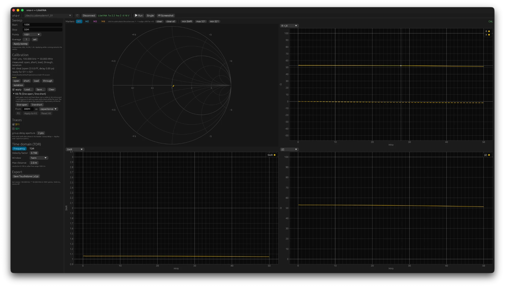

# 4. Calibreren

## Waarom

Het apparaat ziet niet de reflectie van jouw antenne, maar die reflectie gemengd met
drie fouten van zichzelf:

- **richtingsfout** (directivity, e00): een deel van het zendsignaal lekt rechtstreeks in
  de ontvanger, ook als er niets gereflecteerd wordt. Bij de LiteVNA ongeveer −17 tot
  −21 dB boven 1 GHz. Zonder correctie kun je dus nooit beter dan dat meten.
- **bronaanpassing** (source match, e11): de poort zelf is geen perfecte 50 Ω, waardoor
  een gereflecteerde golf nog eens heen en weer kaatst.
- **tracking** (e10e01): de ontvanger heeft een frequentieafhankelijke versterking en
  fase.

Meet je drie afsluitingen waarvan je de reflectie kent, dan heb je per frequentie drie
vergelijkingen met drie onbekenden en los je de fouttermen exact op. Daarna is elke
meting te corrigeren. Dat is de SOL-calibratie: **short**, **open**, **load**. Met een
vierde meting, de **through** (poort 1 direct aan poort 2), komt daar de correctie van S21
bij: isolatie en transmissietracking. De **isolation** (loads op beide poorten) is
optioneel en zelden nodig.

De calibratie geldt voor het frequentieraster waarop hij gemeten is, voor het
referentievlak waar de standaarden zaten, en zolang kabels en adapters niet veranderen.
Verplaats je de kabel naar poort 2 of zet je een adapter tussen, dan calibreer je opnieuw
of je accepteert de fout.

## In de GUI

1. Stel de sweep in (start, stop, punten) en pas hem toe. De calibratie krijgt dit raster.
2. Schroef de **open** op poort 1 en klik **open** in het calibratiepaneel. Idem **short**
   en **load**. Voor S21 ook **through**: kabel van poort 1 naar poort 2.
3. Het paneel meldt "ready for S11" of "ready for S11 + S21". Zet **apply** aan.
4. **Save…** bewaart de calibratie als JSON; **Load…** haalt hem terug. Een geladen
   bestand wordt bij de volgende start automatisch weer geladen. **sweep from
   calibration**, achter het aantal punten en het bereik, zet start, stop en punten van
   de sweep op het raster van de calibratie en past hem toe, zodat er niets
   geïnterpoleerd wordt.

Een standaard die niet klopt, geeft een oranje waarschuwing: een open of short die minder
dan −8 dB reflecteert zit los (een goede open geeft 0 dB op een LiteVNA en ongeveer −3 dB
ruw op een NanoVNA-F), een load boven −10 dB is niet aangesloten of stuk, een
through onder −6 dB zit niet aan poort 2. Neem die serieus; een calibratie met een losse
standaard "lost op" maar geeft onzin, en de meting van de load erna ziet er dan toch
perfect uit omdat de load zijn eigen nulpunt definieert.

Controle na het calibreren: laat de load erop staan en kijk naar S11 met apply aan. Op
HF hoort dat onder −60 dB te zitten, boven 1 GHz onder −40 dB. Draai de load los en
weer vast: de herhaalbaarheid is een paar honderdsten van een dB.

## Met de CLI

```bash
vna-cli cal open --file hf.cal.json --start 1M --stop 30M --points 201
```

```bash
vna-cli cal short --file hf.cal.json
```

```bash
vna-cli cal load --file hf.cal.json
```

```bash
vna-cli cal through --file hf.cal.json
```

Het eerste commando legt het raster vast; de volgende hergebruiken het. `cal show` toont
wat erin zit, `cal check` wat de calibratie op een kabelmeting overlaat (zie onder).
Meten met calibratie:

```bash
vna-cli sweep --cal hf.cal.json
```

Zonder `--start/--stop/--points` wordt het raster van het bestand gebruikt; met een ander
raster binnen het gecalibreerde bereik wordt geïnterpoleerd.

## Interpolatie naar een ander raster

De opgeslagen standaardmetingen worden geïnterpoleerd naar het nieuwe raster (grootte en
fase apart, zodat een snel draaiende fase de grootte niet aantast) en de fouttermen
opnieuw opgelost. Dat werkt goed zolang de fouttermen tussen de
calibratiepunten glad verlopen, en het programma weigert als dat niet zo is:

- **Buiten het bereik** van de calibratie: foutmelding, geen correctie.
- **Te grof raster bij hoge frequentie**: als de fase van de open, short of through
  meer dan 135° draait tussen twee calibratiepunten, is de draairichting dubbelzinnig.
  Calibreer dan met meer punten.
- **Te grof raster aan de onderkant**: een waarschuwing wanneer de sweep punten heeft
  tussen de eerste twee calibratiepunten terwijl het tweede meer dan tweemaal zo hoog ligt
  als het eerste. Een calibratie 50 kHz tot 6,3 GHz in 1001 punten heeft zijn tweede punt
  op 6,35 MHz; daaronder veranderen de brug en de koppelcondensatoren van het apparaat
  zo sterk dat een rechte lijn ertussen een valse impedantiedip van tientallen ohm
  oplevert. Oplossing: een aparte HF-calibratie, en met segmenten (hoofdstuk 3) beide in
  één trace.
- **Een sprong tussen twee calibratiepunten**: een waarschuwing wanneer de sweep punten
  heeft tussen twee calibratiepunten waar een ruwe standaardmeting minstens viermaal
  zoveel verspringt als tussen de punten eromheen. Een VNA die op een bepaalde frequentie
  van signaalbron wisselt, heeft zo'n sprong in alles wat hij ruw meet; een LiteVNA 67
  heeft er een bij 100 MHz. Op het calibratieraster zelf kan dat geen kwaad, maar
  ertussen mengt de correctie de twee kanten: de trace loopt weg naar de
  omschakelfrequentie toe en valt er direct achter terug, een zaagtand van een paar
  megahertz breed. Oplossing: calibreer op het raster waarop je meet. `vna-cli cal show`
  toont de sprongen in een bestand.



## Boven 1 GHz: de kit-fit

Tot ongeveer 1 GHz mag je de standaarden als ideaal beschouwen: open is +1, short is −1,
load is 0. Daarboven telt mee dat een echte open een kleine capaciteit heeft (bij N een
verzonken pen, enkele tientallen femtofarad of een paar picoseconden) en een short een
kleine inductie. Een calibratie met ideale definities laat dan een fout achter die op het
referentievlak onzichtbaar is maar op een kabel als golving verschijnt.

vna-r kan die asymmetrie zelf schatten. Meet, na open/short/load, een kabel van minstens
50 cm met een open en met een short aan het verre eind (**line-open**, **line-short**
onder **Kit fit**). De verhouding van de twee gecorrigeerde magnitudes ribbelt met de
asymmetrie en de kabelfase, en een kleinstekwadratenfit haalt daar de open-capaciteit (of
offset delay) uit. **Fit** rekent, **Apply to kit** zet het in de calibratie, **Reset kit**
maakt het ongedaan. Op de meegeleverde N-kit van de auteur kwam er 40 fF uit, en de
golving op een afgesloten kabel boven 3 GHz halveerde.

Wat de fit niet kan: de load-definitie bepalen. Een load met serie-inductie geeft op een
kabel precies hetzelfde patroon als een open met capaciteit; met één kabel zijn die niet
te scheiden. Wat er na de fit overblijft, blijkt in de praktijk de connectorovergang van
de kabel zelf te zijn (−30 dB), geen calibratiefout. `vna-cli cal check` laat dat per
band zien: de golving op de kabel vóór en na een gate om de verre reflectie, en de term
op het referentievlak. Details in `docs/03-calibratie.md` §8 en §9.

## Poortverlenging

Een calibratie legt het referentievlak waar de standaarden zaten. Zit er achter dat vlak
iets dat niet hoort bij wat je wilt meten (een verloopstuk, een meetklem, een kort
staartje), dan schuift **Port extension** in het calibratiepaneel het vlak naar buiten
met een enkele-weg-vertraging in picoseconden: S11 wordt met tweemaal die vertraging
teruggedraaid, S21 met eenmaal. Het gaat uit van een verliesvrije lijn van 50 Ω, dus het
is voor korte stukjes, niet voor meters kabel (calibreer daarvoor aan het eind).

De vertraging vind je zo: zet een short op het nieuwe vlak en draai tot de trace op de
Smith-chart krimpt tot een punt links, of lees in de TDR-weergave de heen-en-terug-tijd
van de short af en neem de helft. Het paneel toont de bijbehorende lengte bij de huidige
velocity factor. De verlenging geldt voor alles wat getoond wordt, ook bestanden, en
staat in geëxporteerde bestanden vermeld; de calibratie zelf en haar standaarden blijven
onaangeroerd. `0` zet hem uit. Op de commandoregel: `--port-extension <ps>` bij `sweep`
en `tdr`.

## Kit-definities met de hand

Weet je de waarden van je kit (uit het datablad), zet ze dan in het bestand:

```bash
vna-cli cal kit --file x.cal.json --open-c 40 --open-delay 0 --short-l 0 --load-r 50 --kit-name "N kit"
```

Eenheden: fF, ps, pH, Ω.

## Valkuilen op een rij

- **Losse standaard**: oranje waarschuwing, en een ruwe open of short die ver onder 0 dB
  zit. Draai alleen de wartel, nooit het huis.
- **Kapotte load**: een load die ruw als een condensator van een paar pF leest
  (|Z| omgekeerd evenredig met f, Smith-chart in de capacitieve onderhelft) heeft een
  gebroken inwendige verbinding. Controleer met een multimeter: 50 Ω tussen pen en huis.
- **Verkeerd bestand**: het label CAL zegt alleen dat er een calibratie toegepast wordt,
  niet dat het de juiste is. Het paneel toont raster en bestandsnaam.
- **Calibratie van gisteren**: temperatuur en kabelligging veranderen; voor metingen
  onder −50 dB calibreer je vlak van tevoren.
- **Poort 2**: de aanpassing van poort 2 zit niet in het model. Effect op S21 is ongeveer
  |e22|·|S22 van het meetobject|; met een slecht aangepaste uitgang (−10 dB) is dat 1 %,
  voor kabels en verzwakkers niets.
