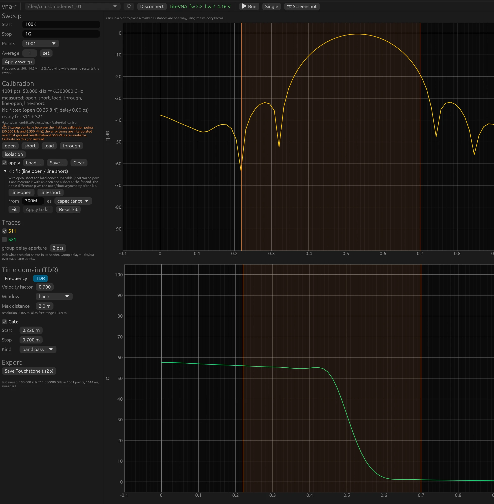

# 5. Tijddomein: TDR en gating

## Van frequentie naar afstand

Stel je voor dat je een extreem korte puls in poort 1 stuurt en luistert naar de echo's.
Elke overgang in de kabel, elke connector, elke fout kaatst een deel terug, en de tijd tot
de echo zegt waar het zit. Dat is tijddomeinreflectometrie (TDR). De VNA zendt geen puls;
hij meet S11 op bijvoorbeeld 1001 frequenties, en een inverse Fourier-transformatie
rekent dat om naar precies het resultaat dat een puls zou geven. Afstand is reistijd maal
lichtsnelheid maal verkortingsfactor, gedeeld door twee omdat het signaal heen en terug
moet.

Kies **TDR** in het paneel **Time domain**. Stel de **Velocity factor** van de kabel in
(0,66 voor RG-58 en RG-213 met massief PE, 0,70 voor RG-316 en veel dunne teflonkabels,
0,82 tot 0,87 voor schuim) en **Max distance** voor de x-as.

## Twee grafieken

**Boven: de impulsresponsie.** Per afstand de sterkte van de echo, |Γ| in dB, 0 dB is
alles terug. Een short of open aan het eind van een kabel is een piek van bijna 0 dB op
de kabellengte; een connectorovergang een bultje van −30 dB; een goede load geeft geen
piek. Dit is het beeld om fouten te lokaliseren.

**Onder: de impedantie langs de lijn.** Dit is de stapresponsie, omgerekend naar ohm:
alsof je een spanningssprong instuurt en kijkt welke impedantie het signaal onderweg
tegenkomt. Een 50 Ω-kabel ligt vlak op 50, een stuk 75 Ω-kabel ertussen springt omhoog,
een short duikt naar 0, een open naar oneindig. Dit is het beeld om te zien wát er zit,
niet alleen waar. De absolute hoogte hangt af van de laagste frequenties van de sweep
(het DC-punt wordt uit de onderste meetpunten geschat); zijn die slecht gecalibreerd, dan
verschuift de hele lijn. Zie de waarschuwing over de onderkant in hoofdstuk 4.



## Resolutie en bereik

Twee getallen onder de instellingen bepalen wat je kunt zien:

- **resolution** = 1 / span. Twee reflecties die dichter bij elkaar liggen dan dit,
  versmelten tot één. Een sweep van 1 GHz breed geeft 1 ns, ofwel 0,10 m bij VF 0,70;
  6,3 GHz geeft 0,16 ns, 1,7 cm. Wil je detail, sweep dan breed. Een HF-sweep van 1 tot
  30 MHz heeft een resolutie van 3,6 m en is voor kabels van een paar meter onbruikbaar;
  het paneel waarschuwt en zet met één knop een geschikte sweep.
- **alias-free range** = 1 / stap. Reflecties van verder weg vouwen terug en lijken
  dichterbij. Een stap van 1 MHz geeft 1 µs, ofwel 105 m bij VF 0,70; wil je een lange
  kabel meten, neem dan meer punten.

De regel: breed sweepen voor detail, fijn (veel punten) voor bereik. 50 kHz tot 6,3 GHz in
1001 punten doet beide redelijk: 1,7 cm resolutie en 17 m bereik.

## Het venster

De gemeten band is eindig en houdt abrupt op. Een abrupte rand in frequentie wordt in de
tijd een sin(x)/x-vorm: een scherpe piek met zijlobben ernaast die maar langzaam
uitsterven. Een kleine reflectie van −40 dB naast een short zou daarin verdrinken. Een
*window* laat het spectrum aan de bandranden geleidelijk naar nul lopen en ruilt daarmee
zijlobben in voor piekbreedte:

| window | zijlobben | piekbreedte | gebruik |
|---|---|---|---|
| rectangular | −13 dB | 1× | twee dicht bijeen liggende fouten scheiden |
| hann | −31,5 dB | 1,6× | de normale keuze |
| blackman | −58 dB | 2,4× | een zwakke reflectie naast een sterke zoeken |

De golving tussen de pieken in de impulsgrafiek zijn meestal deze zijlobben, niet echte
reflecties. Wissel van window: echte reflecties blijven staan, zijlobben veranderen.

## Een kabel doormeten

1. Calibreer op het referentievlak (standaarden direct op poort 1), apply aan.
2. Kabel op poort 1, open of short aan het eind. Sweep 50 kHz tot 6,3 GHz, 1001 punten.
3. TDR: de grote piek is het kabeleind. Klik erop: de uitlezing geeft afstand en tijd.
   Klopt de afstand niet met de meetlat, pas dan de verkortingsfactor aan tot het klopt;
   zo bepaal je de VF van een onbekende kabel.
4. Kleinere pieken onderweg zijn connectoren, knikken, waterschade of een slechte
   soldering. De impedantiegrafiek zegt of het een hoog- of laagohmige fout is.
5. De hoogte van de eindpiek onder 0 dB is tweemaal het kabelverlies op die frequentie
   (heen en terug).

## Gating: een reflectie uitsnijden

Een gate is een venster in de tijd. Je houdt alleen de reflecties tussen **Start** en
**Stop** over (*band pass*) of je haalt juist die weg (*notch*), en het programma rekent
het resultaat terug naar het frequentiedomein. Zo bekijk je een antenne zonder de
connector ervoor, of alleen het antenne-eind van een voedingslijn.

Zet **Gate** aan in het TDR-paneel. De oranje lijnen in de TDR-grafieken zijn sleepbaar;
**Gate around TDR marker** zet ze om de marker. Terug in het frequentiebeeld tonen alle
grafieken, markers en de export de gegate S11, met het label **GATED**. Grijze
stippellijnen markeren de bandranden waar het resultaat niet te vertrouwen is: een gate
van breedte T smeert het frequentiebeeld uit over ongeveer 1/T, dus een gate van 0,5 m
bij VF 0,70 (5 ns) maakt de buitenste 200 MHz aan elke kant onbetrouwbaar. Breder gaten
en breder sweepen helpt beide. Hoe het rekenwerk gaat, staat in `docs/04-tdr.md` §6.

Voorbeeld met een kabel met short: gate van 0,3 tot 0,8 m om de short geeft in het
frequentiebeeld een vlakke |S11| rond 0 dB zonder de golving van de connector; een gate
van −0,1 tot 0,15 m houdt alleen de connectorbult van −30 dB over.

Met de CLI:

```bash
vna-cli tdr --cal x.cal.json --start 50k --stop 6.3G --points 1001 --peaks 5
```

```bash
vna-cli sweep --cal x.cal.json --gate 0.3:0.8 --s2p gegate.s2p
```
