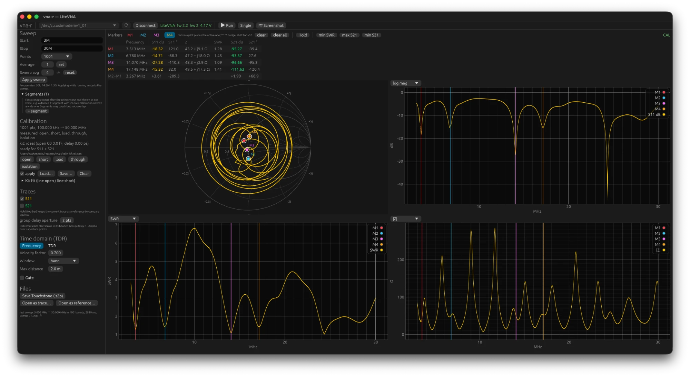
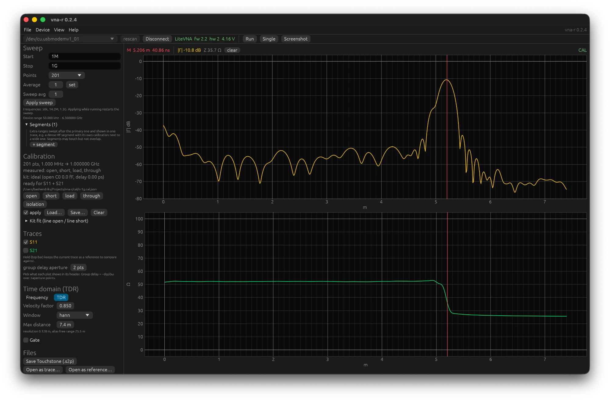
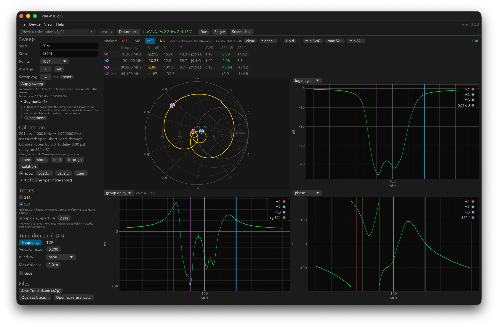

# 6. Meetrecepten

Alle recepten gaan uit van een calibratie op het referentievlak met apply aan
(hoofdstuk 4). Waar een kabel tussen poort en meetobject zit, is de kabel onderdeel van
de meting, tenzij je met de standaarden aan het eind van die kabel calibreert; dan ligt
het referentievlak daar.

## Antenne afregelen

1. Sweep rond de band, ruim genoeg om de resonantie ook te zien als hij ernaast ligt:
   voor 2 m bijvoorbeeld 130 tot 160 MHz, voor 20 m 13 tot 15 MHz. 201 tot 401 punten.
2. Kies **SWR** in één grafiek en **R + jX** in een andere. Klik **min SWR**: de actieve
   marker springt naar de resonantie en de tabel geeft frequentie, SWR en Z.
3. Lees R + jX af op de gewenste frequentie. X negatief (capacitief) betekent dat de
   antenne te kort is voor die frequentie, X positief (inductief) te lang. R zegt of de
   aanpassing überhaupt haalbaar is: ver van 50 Ω helpt inkorten niet, dan is een
   aanpassingsnetwerk nodig.
4. Druk **Hold** voordat je knipt of schuift. De grijze referentie laat zien waar je
   vandaan kwam; met **Δ** zie je het verschil, in dB, SWR of ohm naar keuze.
5. Op een lange voedingslijn: zet een gate om het antenne-eind (hoofdstuk 5) om de
   invloed van connectoren en de lijn zelf te scheiden van de antenne. Of calibreer met de
   standaarden aan het eind van de voedingslijn.

De bandbreedte lees je af met twee markers op de punten waar SWR 2,0 kruist; de regel
M2−M1 geeft het verschil.

Zo ziet dat eruit bij een off-center gevoede draadantenne (OCF) voor HF, gemeten door de
voedingslijn vanuit de shack, 3 tot 30 MHz met 1001 punten en de HF-calibratie van
hoofdstuk 4. De vier markers staan in de SWR-dalen: 3,51 MHz (SWR 1,28), 6,78 MHz
(1,45), 14,07 MHz (1,09) en 17,15 MHz (1,41); verder naar rechts liggen nog dalen rond 24
en 28 MHz. Dat de resonanties in veelvouden van de laagste liggen is precies het idee van
een OCF: door het voedingspunt uit het midden te leggen, is de impedantie daar op de
meeste harmonischen bruikbaar, en de balun brengt die naar 50 Ω. Op 40 m zit hij iets te
laag (6,78 in plaats van 7,1 MHz, dus op de band is hij net te lang; het teken van X zegt
hier weinig, want de voedingslijn draait het, de regel uit stap 3 geldt aan de antenne zelf);
op 20 m staat hij precies goed. Wat ontbreekt is 30 m: rond 10,3 MHz staat de SWR op 6,5.
Dat is geen meetfout maar de antenne zelf. Op de derde harmonische van 3,5 MHz is de
draad anderhalve golflengte lang en heeft de stroomverdeling knopen op precies een derde
en twee derde van de lengte, dus op het voedingspunt van een OCF die op een derde gevoed
wordt. Een stroomknoop betekent een zeer hoge impedantie, en de voedingslijn transformeert
die naar de lage waarde (hier 8 Ω) die je in de shack ziet. Daarom dekt een klassieke
OCF 80, 40, 20, 17, 12 en 10 m en niet 30 m; dezelfde meting met een tweede apparaat
(NanoVNA-F, SMA-kit) gaf dezelfde dalen en hetzelfde gat.

Tussen de banden is de antenne in antiresonantie: de **|Z|**-grafiek schiet daar naar
200 tot 300 Ω en SWR naar 5 tot 7. In de **Smith-chart** is elke band één lus; de lussen
zijn klein en liggen rond het middelpunt omdat de antenne op die frequenties goed is
aangepast, en de curve draait zoveel rondjes omdat de lange voedingslijn de fase met de
frequentie meedraait.

Twee kanttekeningen bij zo'n meting. Omdat het referentievlak in de shack ligt, is de
**R + jX** die je afleest wat de zender ziet, niet wat de antenne zelf doet: de coax
transformeert de impedantie mee. Voor afregelen op SWR maakt dat niet uit (SWR verandert
op een verliesarme lijn nauwelijks langs de lijn), voor de impedantie van de antenne
zelf calibreer je aan het antenne-eind of gebruik je de gate. En de S21-kolommen in de
markertabel staan op −95 dB omdat er niets aan poort 2 hangt: dat is de ruisvloer, geen
meting.

## Kabel: lengte, verkortingsfactor, verlies

**Lengte.** TDR met open of short aan het eind, piek aanklikken, afstand aflezen. De
nauwkeurigheid is de resolutie (hoofdstuk 5): met 6,3 GHz span ruim onder 2 cm.

**Verkortingsfactor.** Meet een stuk kabel van bekende lengte met de meetlat, en pas
**Velocity factor** aan tot de TDR-piek op die lengte staat. Of uit de groepsvertraging:
kabel van poort 1 naar poort 2, weergave **group delay** van S21; τ = L/(c·VF), dus
VF = L/(c·τ). 53 cm kabel met 2,5 ns is VF 0,71.

**Verlies.** Kabel van poort 1 naar poort 2, **log mag** van S21: de demping per
frequentie, direct af te lezen. Zonder tweede poort: short aan het eind en S11 in dB
delen door twee (heen en terug), met de kanttekening dat een short zelf niet perfect is.

**Wat er aan het eind zit.** De impedantiegrafiek van de TDR zegt waarmee de kabel is
afgesloten, niet alleen waar. Hier zit een weerstand van 25 Ω achter 5 m coax: de piek is
−10,8 dB (een reflectie van een derde is −9,5 dB; de overige 1,3 dB is kabelverlies heen
en terug), en de impedantie loopt vlak op 50 Ω tot aan het eind en zakt dan naar ongeveer
26 Ω. De marker staat op de flank en leest een waarde ertussenin; een paar centimeter
verder leest hij de weerstand.

## Filter

Kabel van poort 1 naar de ingang, uitgang naar poort 2, through-calibratie met beide
kabels aan elkaar. **log mag** van S21 toont doorlaatband en stopband; **min S21** of
**max S21** zetten de marker op het diepste of hoogste punt. Twee markers op de
−3 dB-punten geven de bandbreedte. **group delay** laat zien hoe de looptijd aan de
bandranden oploopt; een filter voor data of smalle digitale modes wil die zo vlak
mogelijk.

De schermafdruk toont een notchfilter voor de FM-omroepband, een FLT201A/N, van 50 tot
150 MHz. **min S21** zette M3 op het diepste punt, −45,6 dB op 90,8 MHz; M1 en M2 staan
op de −3 dB-punten en de Δ-regel geeft 44,1 MHz daartussen. S11 bij M3 is maar −2,85 dB:
een notchfilter absorbeert de band die het tegenhoudt niet, het kaatst hem terug, en de
Smith-chart loopt daar dan ook naar de rand. De onderste plots tonen groepsvertraging en
fase van S21, allebei op hun wildst precies in de notch.

De dynamiek van de LiteVNA is ongeveer 90 dB op HF en 60 tot 70 dB boven 3 GHz; een
stopband van −100 dB meet je dus niet. Middelen (Sweep avg 16 of meer) haalt nog zo'n
10 dB extra uit de ruis.

## Verzwakker en versterker

Als een filter. Een verzwakker van 20 dB hoort vlak op −20 dB te liggen, met S11 ver
onder −20 dB aan de ingang. Voor een versterker: de LiteVNA zendt ongeveer 0 dBm; zet
een verzwakker tussen uitgang en poort 2 zodat er niet meer dan −10 dBm op poort 2 komt,
en tel die demping bij S21 op. Nooit een versterker met meer dan een paar milliwatt
uitgang rechtstreeks op poort 2.

## Onbekend onderdeel aan één poort

Spoel, condensator, trap, balun-ingang: S11 met **R + jX**. Een spoel geeft positieve X
die met f oploopt (L = X/(2πf)), een condensator negatieve X die met f afneemt
(C = −1/(2πfX)). Waar X door nul gaat, is de eigenresonantie. Meet dicht bij het
referentievlak; elke centimeter kabel ertussen draait de fase en verschuift de uitkomst.
Gating kan de aansluiting wegsnijden als die onvermijdelijk is.

## Voor/na vergelijken

**Hold** voor de ingreep, meten na de ingreep, **Δ** aan. Voor vergelijkingen over dagen:
exporteer als Touchstone en open later als referentie (hoofdstuk 7). Let op dat
referentie en live meting dezelfde calibratie en hetzelfde referentievlak hebben,
anders vergelijk je ook de calibraties.
