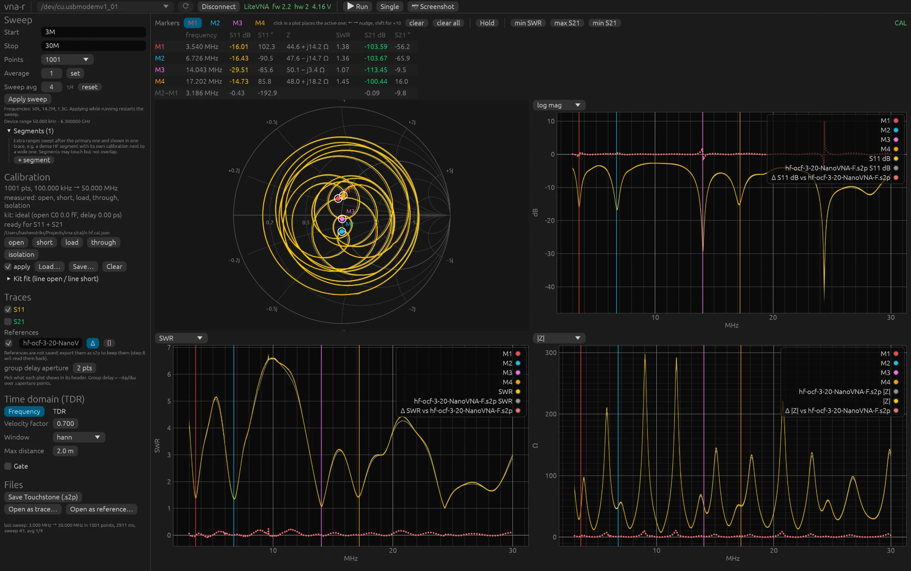

# 9. Apparaten, platform en problemen oplossen

## LiteVNA 64 en 67, NanoVNA-F

De LiteVNA's spreken het binaire registerprotocol en zijn over USB niet aan hun
registers te onderscheiden; de NanoVNA-F spreekt de tekst-shell van de NanoVNA-familie.
vna-r kiest het protocol aan het USB-id en is op alle drie geverifieerd.

| | LiteVNA 67 | LiteVNA 64 | NanoVNA-F 4.3 |
|---|---|---|---|
| protocol | binair (registers) | binair (registers) | tekst-shell, `scan_bin` |
| bereik | 50 kHz – 6,3 GHz | 50 kHz – 6,3 GHz | 10 kHz – 1,5 GHz |
| scherm | 1024×600 | 480×320 | 800×480 |
| USB-id en naam | 04B4:0008 ZeenKo.tech LiteVNA6 | 04B4:0008 Black Sphere Technologies CDC-ACM Demo | 0483:5740 DEEPELEC.COM NanoVNA-F |
| poort op macOS | /dev/cu.usbmodemv1_01 | /dev/cu.usbmodemDEMO1 | /dev/cu.usbmodem\<serienummer\> |
| snelheid | 300–600 punten/s | ~300 punten/s | ~115 punten/s (S11+S21), 301 per stuk |
| niet beschikbaar | | | Average/kanaal, `peek`, USB MODE |

Wat de NanoVNA-F anders doet: zijn scherm blijft werken tijdens een meting, langere
sweeps gaan in stukken van 301 punten, hij meet boven 280 MHz op harmonischen (minder
dynamiek), en zijn bandbreedte stel je op het apparaat in. Boven 1,5 GHz meet hij wel
iets maar betekent het niets; de GUI waarschuwt als de sweep buiten het bereik ligt.
De calibratie van vna-r werkt op zijn ruwe data net als bij de LiteVNA.

NanoVNA-H, H4 en de LiteVNA-H1 gebruiken dezelfde shell met andere firmware; ze zijn
niet getest en werken als hun firmware `scan_bin` kent (DiSlord-firmware).

Richtwaarden voor wat de apparaten kunnen, gemeten met vna-r en een N-kit:
richtingsfout ruw −17 tot −21 dB boven 1 GHz (daarom calibreren), gecalibreerde load
−65 tot −80 dB op HF, dynamiek van S21 ongeveer 90 dB op HF en 60 tot 70 dB boven 3 GHz,
herhaalbaarheid na los- en vastdraaien ±0,01 dB en ±0,1°.

## Platform

- **macOS**: geen stuurprogramma, poort `/dev/cu.usbmodem…`.
- **Linux**: poort `/dev/ttyACM*`, udev-regel of groep `dialout` voor de rechten,
  bouwpakketten `pkg-config libudev-dev`, een desktop-portal voor de bestandsdialogen, op
  NixOS de flake (hoofdstuk 2).
  CLI en GUI zijn op een NixOS-laptop geverifieerd met de LiteVNA 67 op `/dev/ttyACM0`:
  zelfde registers, 329 punten/s, geen verloren punten, calibratie en markers als op de
  Mac.
- **Windows**: de release bevat een zip voor x86_64 die in de CI wordt gebouwd, maar nog
  niet met een apparaat is geprobeerd. Poorten heten `COM3` en dergelijke; kies ze in de
  GUI of geef `--port COM3`.

**Trage of haperende GUI op Linux** (menu's die laat of soms niet reageren). De GUI tekent
met wgpu, dat per start een grafische adapter kiest: Vulkan als dat kan, anders OpenGL.
Op een oudere NVIDIA-kaart met de open-source nouveau-driver (Kepler, GeForce 600/700)
is Vulkan de experimentele NVK-driver en komen beelden te laat; vna-r herkent die en kiest
daar zelf OpenGL, net als bij software-rendering (llvmpipe) zolang er een echte GPU is.
**Help ▸ About** toont wat er gekozen is. Hapert het toch, start dan met
`WGPU_BACKEND=gl ./vna-gui`; omgekeerd dwingt `WGPU_BACKEND=vulkan` Vulkan af.
`WAYLAND_DISPLAY= ./vna-gui` probeert X11 in plaats van Wayland, en `RUST_LOG=info
./vna-gui` laat op de terminal zien welke adapters er waren en welke is gekozen. Meld wat
hielp, met de regel uit About.

## Foutmeldingen

**"no VNA found"** of de poort ontbreekt in de lijst. Datakabel? Staat het apparaat
aan? Op Linux: rechten (zie boven). Op macOS verschijnen soms twee poorten
(`cu.` en `tty.`); vna-r gebruikt `cu.`. Staan er twee VNA's aan, geef dan `--port` of
kies de poort in de GUI.

**Connect doet niets.** De knop staat uit zolang er geen poort gekozen is, bijvoorbeeld
omdat het apparaat pas na het starten van de GUI is aangesloten of van apparaat
gewisseld is. De poortlijst wordt elke twee seconden ververst (en met **rescan** direct); kies de
poort met de ster en klik opnieuw. Reageert de GUI helemaal niet op klikken terwijl de
poort wel gekozen is, verplaats het venster dan naar een ander scherm: op een macOS-
opstelling met twee schermen van verschillende schaal kwamen klikken op één van de twee
niet aan (een eigenaardigheid van het vensterframework, niet van vna-r).

**"timeout while reading from device"**, **"no NanoVNA shell prompt"** of een fout van de
seriële poort die zegt dat hij bezet is. Een
ander programma heeft de poort (GUI verbonden terwijl je de CLI gebruikt, of
NanoVNA-Saver open). Sluit dat eerst. Komt het incidenteel voor direct na het
aansluiten, probeer dan opnieuw; het apparaat heeft soms een seconde nodig.

**"target grid lies outside the calibrated span"**. De sweep valt buiten het bereik van
het geladen calibratiebestand. Laad het juiste bestand of pas de sweep aan. De sweep
wordt tot die tijd ruw getoond: het paneel zegt "not applied" met deze melding en het
label is RAW, of CAL\* als andere segmenten wel gecalibreerd zijn.

**"calibration grid too coarse to interpolate"**. Te weinig punten in de calibratie voor
deze frequenties; calibreer met meer punten.

**Oranje waarschuwing over de eerste twee calibratiepunten**. De sweep heeft punten onder
het tweede calibratiepunt van een brede calibratie; dat stuk is onbetrouwbaar. Gebruik
een HF-calibratie of segmenten (hoofdstuk 4).

**Oranje waarschuwing bij een standaard**. De gemeten standaard lijkt niet op wat hij
hoort te zijn: losse connector, verkeerde standaard, of stuk. Controleer en meet opnieuw.

**"connection dropped, waiting for …"** in de bovenbalk, in oranje. Het apparaat is van
de USB-bus verdwenen: de kabel of de stekker is bewogen (dat gebeurt makkelijk terwijl je
een standaard op de poort draait), de kabel is losgetrokken, of het apparaat is herstart
of uitgezet. De melding eronder noemt wat er misging, bijvoorbeeld
`sweep: I/O error: Broken pipe`. Je hoeft niets te doen: het programma zoekt de poort
twee keer per seconde, verbindt opnieuw zodra hij een seconde gebleven is en gaat verder
met Run of met de enkele sweep die liep; een melding zegt na hoeveel seconden. Een
contact dat bewogen wordt laat het apparaat komen en gaan zolang je hand aan de connector
zit; het programma wacht dan langer voor het opnieuw verbindt (tot acht seconden), en
blijft wachten zolang het duurt. Een calibratiestandaard
die gemeten werd, wordt niet herhaald; meet hem opnieuw. Na 30 seconden zonder apparaat
staat de knop weer op **Connect**; met **Cancel** ben je daar meteen. Het programma merkt het ook op
als er niets gemeten wordt.
Gebeurt het vaak, probeer dan een andere kabel of poort en houd de kabel vrij van de
connector waaraan je draait.

**De LiteVNA blijft in USB MODE**, of de NanoVNA-F blijft op het raster van de laatste
meting staan. `vna-cli release`, of uit en aan.

## Een probleem melden

Meld fouten en wensen op <https://github.com/pa1bh/vna-r/issues> (**Help ▸ Report a
problem…** in de GUI opent die pagina). Zet erbij welke versie je gebruikt (**Help ▸ About**
of `vna-cli --version`), welk apparaat en welke firmware, en wat je deed. Het makkelijkst:
zet **View ▸ Developer tools** aan en kies **Developer ▸ Copy diagnostics**; dat zet
versie, apparaat, sweep-instellingen, calibratie, de laatste fout en het log op het
klembord, klaar om te plakken. Bij een CLI-probleem helpt de uitvoer met `--trace`.

## Wat je kunt vertrouwen

Een goede gewoonte is om na het calibreren en voor elke serieuze meting drie dingen te
controleren:

1. **Load op het referentievlak**: S11 onder −60 dB op HF en onder −40 dB boven 1 GHz
   (hoofdstuk 4). Zo niet, dan is er iets mis met de calibratie of de load.
2. **Open of short op het referentievlak**: 0 dB vlak, fase 0° resp. 180° en langzaam
   draaiend.
3. **Herhaalbaarheid**: los- en vastdraaien verandert minder dan 0,05 dB.

De sterkste controle is een tweede, onafhankelijke meetketen. Hieronder dezelfde
OCF-draadantenne (hoofdstuk 6) gemeten met twee verschillende apparaten: live in geel de
LiteVNA 67, gecalibreerd met een N-kit op de N-poort, en als grijze referentie de
NanoVNA-F 4.3 met een SMA-kit, opgeslagen als Touchstone en teruggelezen met **Open as
reference…**. Ander apparaat, ander protocol, andere kit, andere adapter naar de
antennekabel. De rode stippellijn is **Δ**, live min referentie, in de eenheid van elke
grafiek.

Δ SWR blijft over de hele band binnen 0,1 tot 0,2 van nul en Δ |Z| binnen enkele ohm,
ook op de antiresonanties waar |Γ| ≈ 0,74 is; in de dalen geven de markers 1,38 tegen
1,42, 1,36 tegen 1,34 en 1,07 tegen 1,09. Dat is de overeenkomst die je van twee
hobbykits met ideale definities mag verwachten, en het zegt dat beide calibraties
deugen. Let op de Δ-trace in de log mag-grafiek: die schiet rond 24,9 MHz omhoog omdat
beide traces daar diep in een dal zitten en het verschil van twee kleine getallen in dB
groot wordt; Δ SWR en Δ |Z| laten op dezelfde plek niets zien. Vergelijk dus in de
eenheid die bij de vraag hoort.

Als een meting verrast, kijk dan eerst **RAW** (apply uit). Ruw hoort een open of short
op 0 dB te staan (op een NanoVNA-F op ongeveer −3,4 dB: zijn brug schaalt anders, de
calibratie rekent dat weg) en een load tussen −10 en −30 dB; staat een "load" ruw op
−3 dB met een fase die langzaam draait, dan maakt zijn middenpen geen contact of is hij
inwendig gebroken. Een multimeter tussen pen en huis moet 50 Ω geven.

Twijfel je aan de software, dan geven GUI en CLI dezelfde getallen op dezelfde
calibratie; een snelle `vna-cli sweep --cal … --rows 10` is de controle.

## Connectoren

N-connectoren gaan lang mee als je alleen de wartel draait en nooit het huis, en als er
geen mannelijke pen in komt die te ver uitsteekt (goedkope adapters en SMA-N-verlopen).
Een te lange pen drukt het vrouwelijke contact van de poort naar binnen; daarna maken
pennen die wel binnen tolerantie zijn geen contact meer. Een pendieptemeter kost minder
dan een nieuwe VNA.

## Onderzoeksnotities

Wie dieper wil: `docs/01-onderzoek-protocol.md` beschrijft het USB-protocol en de
metingen op beide apparaten, `docs/03-calibratie.md` het foutmodel met alle metingen en
de grenzen van de kit-fit, `docs/04-tdr.md` de wiskunde van TDR en gating,
`docs/05-roadmap.md` wat er nog komt, `docs/06-nanovna-shell-protocol.md` het
tekstprotocol van de NanoVNA-F.
