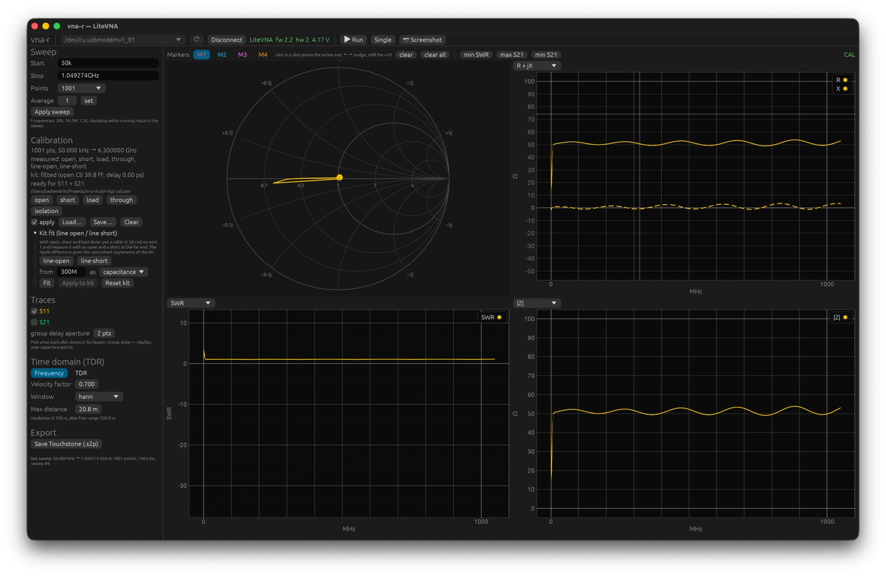
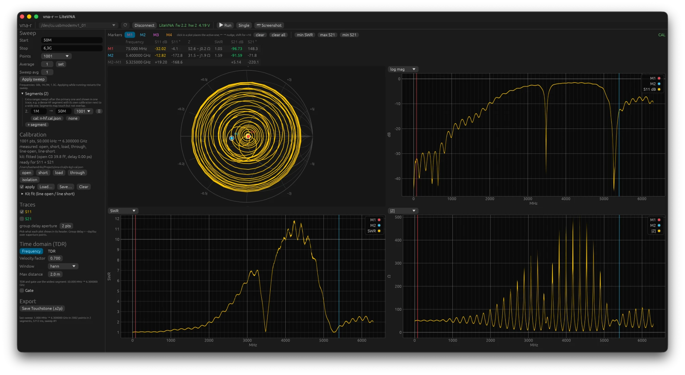
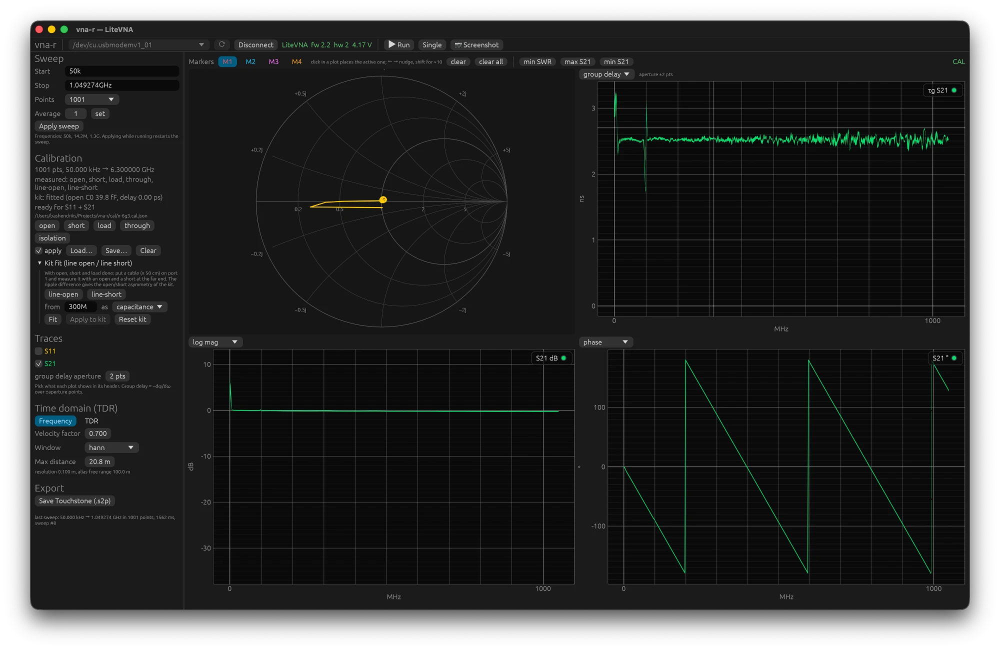

# 3. The GUI

Start with `cargo run --release -p vna-gui` or `target/release/vna-gui`. The window has a
menu bar, a toolbar (port, connection, Run), a left panel with settings and a main area
with four charts. The title bar shows the version number.

## Menu bar

- **File**: open Touchstone files as a trace or as a reference, save as .s2p, load and
  save a calibration, quit. The same buttons are also in the left panel.
- **Device**: Connect or Disconnect, rescan the ports, Run, Stop, a single sweep and a
  screenshot of the device.
- **View**: frequency domain or time domain (TDR), S11 and S21 on or off, **Amateur
  bands** (the IARU Region 1 bands as a grey backdrop with their name in the three
  frequency charts, so you see at once whether a dip lies in the band), **Zoom** (the
  size of the text and everything else, see below), **Connect at start** (connect by
  itself when the program starts and a VNA is plugged in; off by default) and the
  **Developer tools** toggle.
- **Help**: the manual on GitHub in English and in Dutch, as published for your version,
  the issue tracker, and **About vna-r** with the version, build revision, author and the
  link to the project.

**Developer tools** is normally off. Switching it on adds a **Developer** menu with a log
window (connections, errors, file operations and, as long as the window is open, every
sweep with its number of points and duration) and **Copy diagnostics**: that puts the
version, device, sweep settings, calibration, the last error and the log on the clipboard
as text. Paste that into an issue report (chapter 9). The choice is remembered.

### Larger or smaller text

**View ▸ Zoom** sets the size of everything in the window, text and charts alike, from
75% to 250%; the menu shows the size in use. From the keyboard, Ctrl with + and Ctrl
with − (on a Mac ⌘ instead of Ctrl) step by 10%, and Ctrl with 0 goes back to 100%. The
size is remembered. A large size leaves less room for the charts; make the window larger
or scroll in the left panel.

## Connecting and sweeping

1. Choose the port in the drop-down list; a VNA has a star and is selected automatically.
   The list is refreshed every two seconds as long as you are not connected, so a device
   you plug in later appears by itself; **rescan** searches straight away.
2. **Connect**. The top bar shows the model, firmware and battery voltage. If the
   connection drops, the program waits for the device and reconnects by itself (chapter 9).
3. **Run** starts continuous sweeping, **Single** does one sweep. While anything is
   being measured (the continuous sweep, a single sweep or a calibration standard) the
   Run button reads **Stop**.
   A sweep that takes more than a moment (a NanoVNA-F, many points) shows a bar with
   the points measured so far. **Stop**, **Disconnect** and **Apply sweep** do not wait
   for the sweep to finish: they take effect at the next block of data, within 255
   points on a LiteVNA and within 301 points (about three seconds) on a NanoVNA-F.

Keys, as long as you are not typing in a field: space is Run or Stop, `S` a single
sweep, `1` to `4` choose the active marker and the arrow keys move it, `H` holds the
trace as a reference, `G` switches the gate, `T` switches between frequency and time
domain. The battery voltage in the top bar is read again every minute.

Under **Sweep** you set **Start**, **Stop** and **Points** and confirm with **Apply
sweep** or with Return in Start or Stop; during Run the sweep then restarts with the new
settings. You type frequencies as `50k`, `14.2M`, `1.3G` or `6.3G` (a decimal comma is
accepted too). The LiteVNA measures 50 kHz to 6.3 GHz; more points gives finer detail but
takes longer (roughly 300 to 600 points per second).

**Average** (LiteVNA only) is the bandwidth setting of the device itself (1 to 80): higher is
quieter but slower, and the setting stays in the device. **Sweep avg** is something
different: the program averages the last N sweeps as complex values. That suppresses noise
at low levels without distorting the magnitude, and a counter shows how many sweeps are
already included. If you change the grid, the averaging starts over. From three sweeps
on, **drop** leaves the N sweeps farthest from the mean out at every point, so one glitch
(a USB hiccup, a hand near the antenna) does not count; 0 is the plain mean.

## Segments

Under **Segments** you add extra frequency ranges that are swept after the first one and
shown in a single trace. Each segment can have its own calibration file; without a file,
the calibration of the panel is interpolated. The application par excellence is a fine HF
segment with an HF calibration next to a wide segment up to 6.3 GHz, because a wide
calibration is too coarse at the bottom end (chapter 4). Segments may touch each other but
not overlap. TDR and gate work on the widest segment. **log spacing** moves the edges
so that every segment spans the same ratio between the lowest start and the highest stop:
with the same number of points per segment the grid is then dense on HF and coarse on
UHF, which is what 50 kHz to 6 GHz in one picture needs. Points and calibration files
stay with their segment; **Apply sweep** afterwards.

## The four charts

Top left is the Smith chart, always of S11. The three other charts choose in their header
what they show:

| view | unit | what you see |
|---|---|---|
| log mag | dB | \|S11\| and \|S21\| in dB; the default |
| lin mag | – | \|S\| linear, 0 to 1 |
| phase | ° | phase, −180 to +180 |
| SWR | – | standing wave ratio, clipped at 20 |
| R + jX | Ω | resistance (solid) and reactance (dotted) of the port impedance |
| \|Z\| | Ω | modulus of the impedance |
| group delay | ns | −dφ/dω over ±N points; N is set under Traces |

SWR, R + jX and |Z| are about S11 only. Under **Traces** you switch S11 and S21 on or off;
that applies to all charts. The **offset** next to S21 is for an attenuator between the
device under test and port 2: its value in dB is added back, so S21 shows the device alone
in the charts, the markers and the files you save; 0 is off. Double-clicking in a chart resets the scale to automatic;
dragging and scrolling zoom.

## Markers

At the top are M1 to M4. The selected one is active: click in a chart or on the Smith
chart to put it there, and move it with the arrow keys (with shift, ten points at a time).
The table below shows for each marker the frequency, S11 in dB and degrees, Z, the
reactance as the coil or capacitor it is at that frequency (**L / C**: 1 µH, 47 pF), SWR
and S21; if there are two, also the difference, handy for the bandwidth of a filter or
the spacing between two resonances. Hovering over the L / C value gives Q (|X|/R) and the
parallel form of the impedance, R ∥ L or C, for a parallel circuit or a trap. The buttons **min SWR**, **max S21** and **min S21** jump
the active marker to that point.

Top right is a label that says what you are looking at: **CAL** (calibrated), **RAW**
(uncorrected), **CAL\*** (some segments not calibrated), **GATED** (S11 is gated,
chapter 5) or **FILE** (a file instead of the device, chapter 7).

## References

**Hold** in the marker bar freezes the trace as it is shown right now. Up to four
references, each with a name and a colour, are listed under **Traces**; tick them on or
off, rename them, or remove them. The **Δ** button next to a reference draws live minus
reference in every chart, in the unit of that chart: dB, degrees, SWR, ohms or
nanoseconds. That way you see immediately what a change to an antenna does. Note that a
difference in dB becomes large where both traces are deep in a dip (two small numbers);
look at the difference in SWR or |Z| there. Chapter 9 shows a comparison of two devices on
the same antenna done this way. References are kept when you quit and come back at the
next start, with their names; remove them with **×** when you are done with them.

## Screenshot of the device

**Screenshot** fetches the contents of the device's LCD and shows it in a window, with a
button to save it as PNG. Handy for documenting what the device itself was showing.

## What is remembered

On quitting, the following are saved: port, start, stop, points, average, sweep avg,
segments, the calibration file and whether it is applied, the port extension, the view
choices, TDR and gate settings, marker frequencies, **Connect at start**, the zoom and
the window size. At the next start that all comes back;
the calibration file is loaded automatically and the markers are placed at the nearest
frequency on the first sweep. The references are kept too, as files next to the settings.
Not saved are the measurement data of the live trace.
