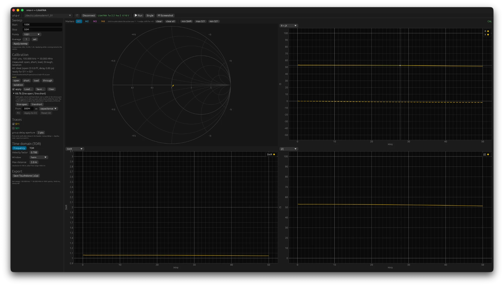

# 4. Calibrating

## Why

The device does not see the reflection of your antenna, but that reflection mixed with
three errors of its own:

- **directivity** (e00): part of the transmitted signal leaks straight into the receiver,
  even when nothing is being reflected. On the LiteVNA roughly −17 to −21 dB above 1 GHz.
  Without correction you can therefore never measure better than that.
- **source match** (e11): the port itself is not a perfect 50 Ω, so a reflected wave
  bounces back and forth once more.
- **tracking** (e10e01): the receiver has a frequency-dependent gain and phase.

If you measure three terminations whose reflection you know, you have three equations
with three unknowns at each frequency and you solve the error terms exactly. After that,
every measurement can be corrected. That is the SOL calibration: **short**, **open**,
**load**. With a fourth measurement, the **through** (port 1 directly to port 2), the
correction of S21 is added: isolation and transmission tracking. The **isolation** (loads
on both ports) is optional and rarely needed.

The calibration is valid for the frequency grid on which it was measured, for the
reference plane where the standards were, and as long as cables and adapters do not
change. If you move the cable to port 2 or put an adapter in between, you calibrate again
or you accept the error.

## In the GUI

1. Set the sweep (start, stop, points) and apply it. The calibration gets this grid.
2. Screw the **open** onto port 1 and click **open** in the calibration panel. Likewise
   **short** and **load**. For S21 also **through**: cable from port 1 to port 2.
3. The panel reports "ready for S11" or "ready for S11 + S21". Switch **apply** on.
4. **Save…** stores the calibration as JSON; **Load…** brings it back. A loaded file is
   loaded again automatically at the next start.

A standard that is not right gives an orange warning: an open or short that reflects less
than −8 dB is loose (a good open reads 0 dB on a LiteVNA and about −3 dB raw on a
NanoVNA-F), a load above −10 dB is not connected or broken, a through below −6 dB
is not attached to port 2. Take those seriously; a calibration with a loose standard
"solves" but gives nonsense, and the measurement of the load afterwards still looks
perfect because the load defines its own zero point.

Check after calibrating: leave the load on and look at S11 with apply on. On HF that should
be below −60 dB, above 1 GHz below −40 dB. Unscrew the load and screw it back on: the
repeatability is a few hundredths of a dB.

## With the CLI

```bash
vna-cli cal open --file hf.cal.json --start 1M --stop 30M --points 201
```

```bash
vna-cli cal short --file hf.cal.json
```

```bash
vna-cli cal load --file hf.cal.json
```

```bash
vna-cli cal through --file hf.cal.json
```

The first command fixes the grid; the following ones reuse it. `cal show` shows what is in
the file, `cal check` what the calibration leaves behind on a cable measurement (see
below). Measuring with a calibration:

```bash
vna-cli sweep --cal hf.cal.json
```

Without `--start/--stop/--points` the grid of the file is used; with a different grid
within the calibrated range it is interpolated.

## Interpolation to a different grid

The stored standard measurements are interpolated to the new grid (magnitude and phase
separately, so a fast-turning phase does not eat into the magnitude) and the error terms
are solved again. That works well as long as the error terms run
smoothly between the calibration points, and the program refuses when that is not the
case:

- **Outside the range** of the calibration: error message, no correction.
- **Grid too coarse at high frequency**: if the phase of the open, short or through
  rotates more than 135° between two calibration points, the direction of rotation is
  ambiguous. Calibrate with more points then.
- **Grid too coarse at the bottom end**: a warning when the sweep has points between the
  first two calibration points while the second one is more than twice as high as the
  first. A calibration from 50 kHz to 6.3 GHz in 1001 points has its second point at
  6.35 MHz; below that, the bridge and the coupling capacitors of the device change so
  strongly that a straight line between the two produces a false impedance dip of tens of
  ohms. Solution: a separate HF calibration, and with segments (chapter 3) both in one
  trace.
- **A jump between two calibration points**: a warning when the sweep has points between
  two calibration points where a raw standard measurement steps at least four times more
  than between the points around them. A VNA that switches its signal source at some
  frequency has such a step in everything it measures raw; a LiteVNA 67 has one near
  100 MHz. On the calibration grid itself that does no harm, but in between the
  correction blends the two sides: the trace runs off towards the switching frequency
  and drops back right behind it, a sawtooth a few megahertz wide. Solution: calibrate
  on the grid you measure on. `vna-cli cal show` lists the jumps in a file.



## Above 1 GHz: the kit fit

Up to about 1 GHz you may regard the standards as ideal: open is +1, short is −1, load is
0. Above that it matters that a real open has a small capacitance (with N a recessed pin,
a few tens of femtofarads or a few picoseconds) and a short a small inductance. A
calibration with ideal definitions then leaves behind an error that is invisible at the
reference plane but shows up as ripple on a cable.

vna-r can estimate that asymmetry itself. After open/short/load, measure a cable of at
least 50 cm with an open and with a short at the far end (**line-open**, **line-short**
under **Kit fit**). The ratio of the two corrected magnitudes ripples with the asymmetry
and the cable phase, and a least-squares fit extracts the open capacitance (or offset
delay) from it. **Fit** calculates, **Apply to kit** puts it in the calibration, **Reset
kit** undoes it. On the N kit supplied with the author's device the result was 40 fF, and
the ripple on a terminated cable above 3 GHz halved.

What the fit cannot do: determine the load definition. A load with series inductance gives
exactly the same pattern on a cable as an open with capacitance; with a single cable the
two cannot be separated. What remains after the fit turns out in practice to be the
connector transition of the cable itself (−30 dB), not a calibration error. `vna-cli cal
check` shows that per band: the ripple on the cable before and after a gate around the far
reflection, and the term at the reference plane. Details in `docs/03-calibratie.md`
(Dutch) §8 and §9.

## Port extension

A calibration puts the reference plane where the standards were. If something sits behind
that plane that is not part of what you want to measure (an adapter, a fixture, a short
pigtail), **Port extension** in the calibration panel moves the plane outward by a
one-way delay in picoseconds: S11 is turned back by twice that delay, S21 by once. It
assumes a lossless 50 Ω line, so it is for short pieces, not for metres of cable
(calibrate at the far end for that).

To find the delay: put a short at the new plane and tune until the trace on the Smith
chart shrinks to a dot at the left, or read the round-trip time of the short in the TDR
view and take half. The panel shows the equivalent length at the current velocity factor.
The extension applies to everything shown, files included, and is noted in exported
files; the calibration itself and its standards are not touched. `0` switches it off. On
the command line: `--port-extension <ps>` with `sweep` and `tdr`.

## Kit definitions by hand

If you know the values of your kit (from the data sheet), put them in the file:

```bash
vna-cli cal kit --file x.cal.json --open-c 40 --open-delay 0 --short-l 0 --load-r 50 --kit-name "N kit"
```

Units: fF, ps, pH, Ω.

## Pitfalls at a glance

- **Loose standard**: orange warning, and a raw open or short that sits far below 0 dB.
  Turn only the coupling nut, never the body.
- **Broken load**: a load that reads raw as a capacitor of a few pF (|Z| inversely
  proportional to f, Smith chart in the capacitive lower half) has a broken internal
  connection. Check with a multimeter: 50 Ω between pin and body.
- **Wrong file**: the CAL label only says that a calibration is being applied, not that it
  is the right one. The panel shows the grid and the file name.
- **Yesterday's calibration**: temperature and cable position change; for measurements
  below −50 dB you calibrate just beforehand.
- **Port 2**: the match of port 2 is not in the model. The effect on S21 is roughly
  |e22|·|S22 of the device under test|; with a poorly matched output (−10 dB) that is 1 %,
  for cables and attenuators nothing.
