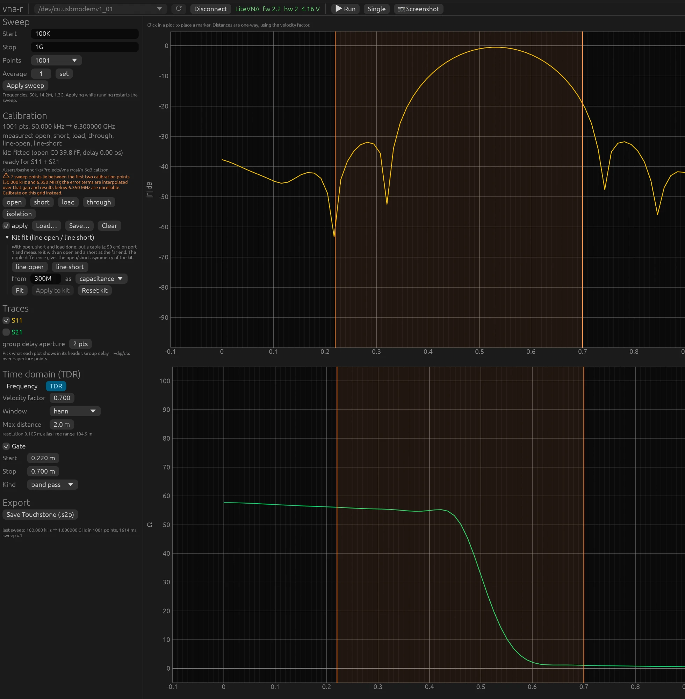
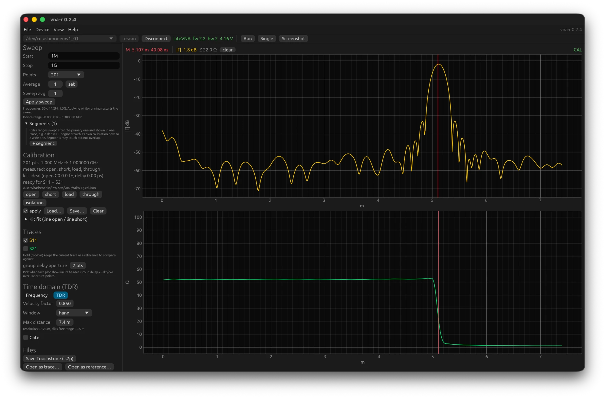

# 5. Time domain: TDR and gating

## From frequency to distance

Imagine sending an extremely short pulse into port 1 and listening for the echoes. Every
transition in the cable, every connector, every fault reflects part of it back, and the
time until the echo tells you where it is. That is time-domain reflectometry (TDR). The
VNA does not send a pulse; it measures S11 at, say, 1001 frequencies, and an inverse
Fourier transform converts that into exactly the result a pulse would give. Distance is
travel time times the speed of light times the velocity factor, divided by two because the
signal has to go there and back.

Choose **TDR** in the **Time domain** panel. Set the **Velocity factor** of the cable
(0.66 for RG-58 and RG-213 with solid PE, 0.70 for RG-316 and many thin Teflon cables,
0.82 to 0.87 for foam) and **Max distance** for the x-axis.

## Two graphs

**Top: the impulse response.** For each distance, the strength of the echo, |Γ| in dB,
where 0 dB is everything coming back. A short or open at the end of a cable is a peak of
almost 0 dB at the cable length; a connector transition a bump of −30 dB; a good load
gives no peak. This is the picture for locating faults.

**Bottom: the impedance along the line.** This is the step response, converted to ohms:
as if you send in a voltage step and watch which impedance the signal meets along the way.
A 50 Ω cable lies flat at 50, a piece of 75 Ω cable in between jumps up, a short dives to
0, an open to infinity. This is the picture for seeing *what* is there, not just where.
The one value a VNA cannot measure, S11 at 0 Hz, is chosen so that nothing reflects
before the reference plane. The lowest measured frequencies still shape the slow part of
the step, so a poorly calibrated bottom end (see the warning in chapter 4) shows up as a
tilt of the line rather than a shift.



## Resolution and range

Two numbers below the settings determine what you can see:

- **resolution** = 1 / span. Two reflections that lie closer together than this merge
  into one. A sweep 1 GHz wide gives 1 ns, or 0.10 m at VF 0.70; 6.3 GHz gives 0.16 ns,
  1.7 cm. If you want detail, sweep wide. An HF sweep from 1 to 30 MHz has a resolution
  of 3.6 m and is useless for cables of a few metres; the panel warns and sets a suitable
  sweep with one button.
- **alias-free range** = 1 / step. Reflections from further away fold back and appear
  closer. A step of 1 MHz gives 1 µs, or 105 m at VF 0.70; if you want to measure a long
  cable, take more points.

The rule: sweep wide for detail, fine (many points) for range. 50 kHz to 6.3 GHz in
1001 points does both reasonably: 1.7 cm resolution and 17 m range.

## The window

The measured band is finite and stops abruptly. An abrupt edge in frequency becomes a
sin(x)/x shape in time: a sharp peak with side lobes next to it that die out only slowly.
A small reflection of −40 dB next to a short would drown in them. A *window* lets the
spectrum run gradually to zero at the band edges and thereby trades side lobes for peak
width:

| window | side lobes | peak width | use |
|---|---|---|---|
| rectangular | −13 dB | 1× | separating two faults that lie close together |
| hann | −31.5 dB | 1.6× | the normal choice |
| blackman | −58 dB | 2.4× | finding a weak reflection next to a strong one |

The ripple between the peaks in the impulse graph is usually these side lobes, not real
reflections. Switch windows: real reflections stay put, side lobes change.

## Measuring a cable

1. Calibrate at the reference plane (standards directly on port 1), apply on.
2. Cable on port 1, open or short at the end. Sweep 50 kHz to 6.3 GHz, 1001 points.
3. TDR: the big peak is the cable end. Click on it: the readout gives distance and time.
   If the distance does not match the tape measure, adjust the velocity factor until it
   does; that is how you determine the VF of an unknown cable.
4. Smaller peaks along the way are connectors, kinks, water damage or a bad solder
   joint. The impedance graph tells you whether it is a high- or low-impedance fault.
5. The height of the end peak below 0 dB is twice the cable loss at that frequency
   (there and back).



Steps 1 to 3 on a longer cable: 1 MHz to 1 GHz in 201 points, on the grid of the 1 GHz
calibration, with a short at the end. The marker on the peak reads 5.1 m and 40 ns at
VF 0.85; the −1.8 dB is twice the loss of the cable. Below it the impedance lies flat at
50 Ω up to the end and then dives to 0, which is what a short does.

## Gating: cutting out a reflection

A gate is a window in time. You keep only the reflections between **Start** and
**Stop** (*band pass*) or you remove exactly those (*notch*), and the program converts
the result back to the frequency domain. That way you can look at an antenna without the
connector in front of it, or at only the antenna end of a feed line.

Switch **Gate** on in the TDR panel. The orange lines in the TDR graphs can be dragged;
**Gate around TDR marker** puts them around the marker. Back in the frequency view, all
graphs, markers and the export show the gated S11, with the label **GATED**. Grey dashed
lines mark the band edges where the result cannot be trusted: a gate of width T smears
the frequency picture over about 1/T, so a gate of 0.5 m at VF 0.70 (5 ns) makes the
outermost 200 MHz on each side unreliable. Gating wider and sweeping wider both help.
How the calculation works is described in `docs/04-tdr.md` §6 (Dutch).

Example with a cable with a short: a gate from 0.3 to 0.8 m around the short gives a flat
|S11| around 0 dB in the frequency view, without the ripple from the connector; a gate
from −0.1 to 0.15 m keeps only the connector bump of −30 dB.

With the CLI:

```bash
vna-cli tdr --cal x.cal.json --start 50k --stop 6.3G --points 1001 --peaks 5
```

```bash
vna-cli sweep --cal x.cal.json --gate 0.3:0.8 --s2p gated.s2p
```
