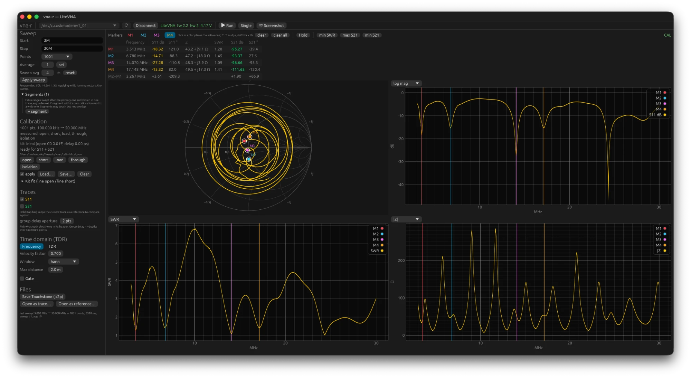

# 6. Measurement recipes

All recipes assume a calibration at the reference plane with apply on (chapter 4). Where
a cable sits between the port and the device under test, the cable is part of the
measurement, unless you calibrate with the standards at the end of that cable; then the
reference plane is there.

## Tuning an antenna

1. Sweep around the band, wide enough to see the resonance even if it lies next to the
   band: for 2 m, say, 130 to 160 MHz, for 20 m 13 to 15 MHz. 201 to 401 points.
2. Choose **SWR** in one graph and **R + jX** in another. Click **min SWR**: the active
   marker jumps to the resonance and the table gives frequency, SWR and Z.
3. Read R + jX at the desired frequency. Negative X (capacitive) means the antenna is
   too short for that frequency, positive X (inductive) too long. R tells you whether a
   match is achievable at all: far from 50 Ω, shortening does not help; then a matching
   network is needed.
4. Press **Hold** before you cut or slide. The grey reference shows where you came from;
   with **Δ** you see the difference, in dB, SWR or ohms as you choose.
5. On a long feed line: put a gate around the antenna end (chapter 5) to separate the
   influence of connectors and the line itself from the antenna. Or calibrate with the
   standards at the end of the feed line.

You read the bandwidth with two markers on the points where the SWR crosses 2.0; the
M2−M1 row gives the difference.

This is what that looks like for an off-centre-fed wire antenna (OCF) for HF, measured
through the feed line from the shack, 3 to 30 MHz with 1001 points and the HF calibration
from chapter 4. The four markers sit in the SWR dips: 3.51 MHz (SWR 1.28), 6.78 MHz
(1.45), 14.07 MHz (1.09) and 17.15 MHz (1.41); further to the right there are more dips
around 21 and 28 MHz. That the resonances lie at multiples of the lowest one is exactly
the idea of an OCF: by placing the feed point away from the centre, the impedance there is
usable on most harmonics, and the balun brings it to 50 Ω. On 40 m it sits a little low
(6.78 instead of 7.1 MHz, so on the band it is just too long; the sign of X says little
here because the feed line rotates it, the rule of step 3 holds at the antenna itself); on
20 m it is spot on. What is missing is 30 m: around 10.3 MHz the SWR is 6.5. That is not a
measurement error but the antenna itself. On the third harmonic of 3.5 MHz the wire is one
and a half wavelengths long and the current distribution has nodes at exactly one third
and two thirds of the length, so at the feed point of an OCF that is fed at one third. A
current node means a very high impedance, and the feed line transforms that into the low
value (here 8 Ω) that you see in the shack. That is why a classic OCF covers 80, 40, 20,
17, 12 and 10 m and not 30 m; the same measurement with a second device (NanoVNA-F, SMA
kit) gave the same dips and the same gap.

Between the bands the antenna is at anti-resonance: the **|Z|** graph shoots up there to
200 to 300 Ω and the SWR to 5 to 7. In the **Smith chart**, every band is one loop; the
loops are small and lie around the centre because the antenna is well matched at those
frequencies, and the curve goes round so many times because the long feed line rotates
the phase with frequency.

Two caveats with such a measurement. Because the reference plane is in the shack, the
**R + jX** you read is what the transmitter sees, not what the antenna itself does: the
coax transforms the impedance along with it. For tuning on SWR that does not matter (on a
low-loss line the SWR hardly changes along the line); for the impedance of the antenna
itself you calibrate at the antenna end or use the gate. And the S21 columns in the
marker table read −95 dB because nothing is connected to port 2: that is the noise floor,
not a measurement.

## Cable: length, velocity factor, loss

**Length.** TDR with an open or short at the end, click the peak, read off the distance.
The accuracy is the resolution (chapter 5): with a 6.3 GHz span well under 2 cm.

**Velocity factor.** Measure a piece of cable of known length with the tape measure, and
adjust **Velocity factor** until the TDR peak sits at that length. Or from the group
delay: cable from port 1 to port 2, display **group delay** of S21; τ = L/(c·VF), so
VF = L/(c·τ). A 53 cm cable with 2.5 ns is VF 0.71.

**Loss.** Cable from port 1 to port 2, **log mag** of S21: the attenuation per frequency,
read off directly. Without a second port: short at the end and divide S11 in dB by two
(there and back), with the caveat that a short itself is not perfect.

## Filter

Cable from port 1 to the input, output to port 2, through calibration with both cables
connected together. **log mag** of S21 shows the passband and stopband; **min S21** or
**max S21** put the marker on the lowest or highest point. Two markers on the −3 dB
points give the bandwidth. **group delay** shows how the delay rises at the band edges; a
filter for data or narrow digital modes wants that as flat as possible.

The dynamic range of the LiteVNA is about 90 dB on HF and 60 to 70 dB above 3 GHz; so a
stopband of −100 dB is not something you can measure. Averaging (Sweep avg 16 or more)
pulls another 10 dB or so out of the noise.

## Attenuator and amplifier

Like a filter. A 20 dB attenuator should lie flat at −20 dB, with S11 well below −20 dB
at the input. For an amplifier: the LiteVNA transmits about 0 dBm; put an attenuator
between the output and port 2 so that no more than −10 dBm arrives at port 2, and add
that attenuation to S21. Never connect an amplifier with more than a few milliwatts of
output directly to port 2.

## Unknown component on one port

Coil, capacitor, trap, balun input: S11 with **R + jX**. A coil gives positive X that
rises with f (L = X/(2πf)), a capacitor negative X that decreases with f
(C = −1/(2πfX)). Where X passes through zero is the self-resonance. Measure close to the
reference plane; every centimetre of cable in between rotates the phase and shifts the
result. Gating can cut away the connection if it is unavoidable.

## Comparing before and after

**Hold** before the change, measure after the change, **Δ** on. For comparisons over days:
export as Touchstone and open it later as a reference (chapter 7). Make sure that the
reference and the live measurement have the same calibration and the same reference
plane, otherwise you are comparing the calibrations as well.
