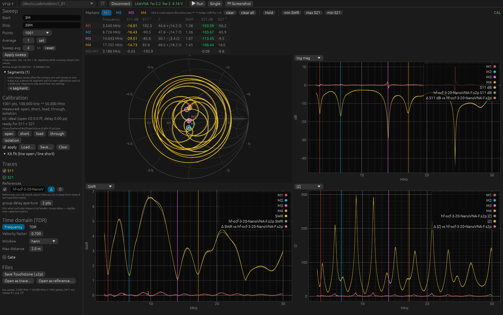

# 9. Devices, platform and troubleshooting

## LiteVNA 64 and 67, NanoVNA-F

The LiteVNAs speak the binary register protocol and cannot be told apart by their
registers over USB; the NanoVNA-F speaks the text shell of the NanoVNA family.
vna-r chooses the protocol by the USB id and has been verified on all three.

| | LiteVNA 67 | LiteVNA 64 | NanoVNA-F 4.3 |
|---|---|---|---|
| protocol | binary (registers) | binary (registers) | text shell, `scan_bin` |
| range | 50 kHz – 6.3 GHz | 50 kHz – 6.3 GHz | 10 kHz – 1.5 GHz |
| screen | 1024×600 | 480×320 | 800×480 |
| USB id and name | 04B4:0008 ZeenKo.tech LiteVNA6 | 04B4:0008 Black Sphere Technologies CDC-ACM Demo | 0483:5740 DEEPELEC.COM NanoVNA-F |
| port on macOS | /dev/cu.usbmodemv1_01 | /dev/cu.usbmodemDEMO1 | /dev/cu.usbmodem\<serial number\> |
| speed | 300–600 points/s | ~300 points/s | ~115 points/s (S11+S21), 301 per chunk |
| not available | | | Average/channel, `peek`, USB MODE |

What the NanoVNA-F does differently: its screen keeps working during a measurement, longer
sweeps go in chunks of 301 points, above 280 MHz it measures on harmonics (less
dynamic range), and you set its bandwidth on the device itself. Above 1.5 GHz it does
measure something, but it means nothing; the GUI warns when the sweep lies outside the range.
The calibration of vna-r works on its raw data just as with the LiteVNA.

NanoVNA-H, H4 and the LiteVNA-H1 use the same shell with different firmware; they are
untested and will work if their firmware knows `scan_bin` (DiSlord firmware).

Indicative figures for what the devices can do, measured with vna-r and an N kit:
raw directivity error −17 to −21 dB above 1 GHz (hence calibrating), calibrated load
−65 to −80 dB on HF, S21 dynamic range about 90 dB on HF and 60 to 70 dB above 3 GHz,
repeatability after unscrewing and reconnecting ±0.01 dB and ±0.1°.

## Platform

- **macOS**: no driver, port `/dev/cu.usbmodem…`.
- **Linux**: port `/dev/ttyACM*`, a udev rule or the `dialout` group for the permissions,
  build packages `pkg-config libudev-dev`, a desktop portal for the file dialogs, on NixOS
  the flake (chapter 2).
  CLI and GUI have been verified on a NixOS laptop with the LiteVNA 67 on `/dev/ttyACM0`:
  same registers, 329 points/s, no lost points, calibration and markers as on the
  Mac.
- **Windows**: the release carries an x86_64 zip built in CI, not yet tried with a device.
  Ports are named `COM3` and the like; pick them in the GUI or pass `--port COM3`.

**Slow or stuttering GUI on Linux** (menus that react late or sometimes not at all). The GUI
draws with wgpu, which picks a graphics adapter at start: Vulkan when it can, otherwise
OpenGL. On an older NVIDIA card with the open-source nouveau driver (Kepler, GeForce
600/700) Vulkan is the experimental NVK driver and frames arrive late; vna-r recognises it
and picks OpenGL there itself, as it does for software rendering (llvmpipe) whenever a
real GPU is available. **Help ▸ About** shows what was chosen. If it still stutters, start
with `WGPU_BACKEND=gl ./vna-gui`; conversely `WGPU_BACKEND=vulkan` forces Vulkan.
`WAYLAND_DISPLAY= ./vna-gui` tries X11 instead of Wayland, and `RUST_LOG=info ./vna-gui`
prints on the terminal which adapters were found and which one was chosen. Report what
helped, with the line from About.

## Error messages

**"no VNA found"** or the port is missing from the list. Data cable? Is the device
switched on? On Linux: permissions (see above). On macOS two ports sometimes appear
(`cu.` and `tty.`); vna-r uses `cu.`. If two VNAs are switched on, pass `--port` or
choose the port in the GUI.

**Connect does nothing.** The button is disabled as long as no port has been chosen, for
example because the device was only connected after the GUI was started, or because you
switched devices. The port list is refreshed every two seconds (and immediately with **rescan**); choose the
port with the star and click again. If the GUI does not respond to clicks at all while a
port has been chosen, move the window to another screen: on a macOS setup with two
screens of different scale, clicks on one of the two did not arrive (a quirk of the
window framework, not of vna-r).

**"timeout while reading from device"**, **"no NanoVNA shell prompt"** or a serial port
error that says the port is busy. Another
program has the port (GUI connected while you use the CLI, or NanoVNA-Saver open).
Close that first. If it happens occasionally right after plugging in, try again; the
device sometimes needs a second.

**"target grid lies outside the calibrated span"**. The sweep falls outside the span of
the loaded calibration file. Load the right file or adjust the sweep. Until then the
sweep is shown raw: the panel says "not applied" with this message and the label is RAW,
or CAL\* when other segments are calibrated.

**"calibration grid too coarse to interpolate"**. Too few points in the calibration for
these frequencies; calibrate with more points.

**Orange warning about the first two calibration points**. The sweep has points below
the second calibration point of a wide calibration; that part is unreliable. Use an
HF calibration or segments (chapter 4).

**Orange warning next to a standard**. The measured standard does not look like what it
should be: loose connector, wrong standard, or broken. Check and measure again.

**"I/O error"** in the top bar during a sweep, and the button is back on **Connect**. The
connection dropped: the cable was moved or unplugged, or the device was switched off.
Plug it back in, wait for the port to appear in the list and click **Connect**.

**The LiteVNA stays in USB MODE**, or the NanoVNA-F stays on the grid of the last
measurement. `vna-cli release`, or switch it off and on.

## Reporting a problem

Report bugs and wishes at <https://github.com/pa1bh/vna-r/issues> (**Help ▸ Report a
problem…** in the GUI opens that page). Include which version you use (**Help ▸ About**
or `vna-cli --version`), which device and which firmware, and what you were doing. The easiest way:
switch on **View ▸ Developer tools** and choose **Developer ▸ Copy diagnostics**; that puts the
version, device, sweep settings, calibration, the last error and the log on the
clipboard, ready to paste. For a CLI problem, the output with `--trace` helps.

## What you can trust

A good habit is to check three things after calibrating and before every serious
measurement:

1. **Load on the reference plane**: S11 below −60 dB on HF and below −40 dB above 1 GHz
   (chapter 4). If not, something is wrong with the calibration or the load.
2. **Open or short on the reference plane**: 0 dB flat, phase 0° or 180° respectively and
   slowly rotating.
3. **Repeatability**: unscrewing and reconnecting changes less than 0.05 dB.

The strongest check is a second, independent measurement chain. Below, the same
OCF wire antenna (chapter 6) measured with two different devices: live in yellow the
LiteVNA 67, calibrated with an N kit on the N port, and as the grey reference the
NanoVNA-F 4.3 with an SMA kit, saved as Touchstone and read back with **Open as
reference…**. Different device, different protocol, different kit, different adapter to the
antenna cable. The red dotted line is **Δ**, live minus reference, in the unit of each
graph.

Δ SWR stays within 0.1 to 0.2 of zero across the whole band and Δ |Z| within a few ohms,
also at the anti-resonances where |Γ| ≈ 0.74; in the dips the markers give 1.38 against
1.42, 1.36 against 1.34 and 1.07 against 1.09. That is the agreement you may expect from two
hobby kits with ideal definitions, and it says that both calibrations are
sound. Note the Δ trace in the log mag graph: it shoots up around 24.9 MHz because
both traces are deep in a dip there and the difference of two small numbers in dB
becomes large; Δ SWR and Δ |Z| show nothing at the same spot. So compare in the
unit that fits the question.

If a measurement surprises you, look at **RAW** first (apply off). Raw, an open or short
should sit at 0 dB (on a NanoVNA-F at about −3.4 dB: its bridge scales differently, the
calibration takes that out) and a load between −10 and −30 dB; if a "load" sits raw at
−3 dB with a phase that rotates slowly, its centre pin is not making contact or it is
broken internally. A multimeter between pin and body should read 50 Ω.

If you doubt the software, GUI and CLI give the same numbers on the same
calibration; a quick `vna-cli sweep --cal … --rows 10` is the check.

## Connectors

N connectors last a long time if you only turn the coupling nut and never the body, and if
no male pin goes in that protrudes too far (cheap adapters and SMA-to-N adapters).
A pin that is too long pushes the female contact of the port inwards; after that, pins
that are within tolerance no longer make contact. A pin depth gauge costs less
than a new VNA.

## Research notes

For those who want to go deeper: `docs/01-onderzoek-protocol.md` (Dutch) describes the USB
protocol and the measurements on both devices, `docs/03-calibratie.md` the error model
with all measurements and the limits of the kit fit, `docs/04-tdr.md` the mathematics of
TDR and gating, `docs/05-roadmap.md` what is still to come,
`docs/06-nanovna-shell-protocol.md` the text protocol of the NanoVNA-F.
